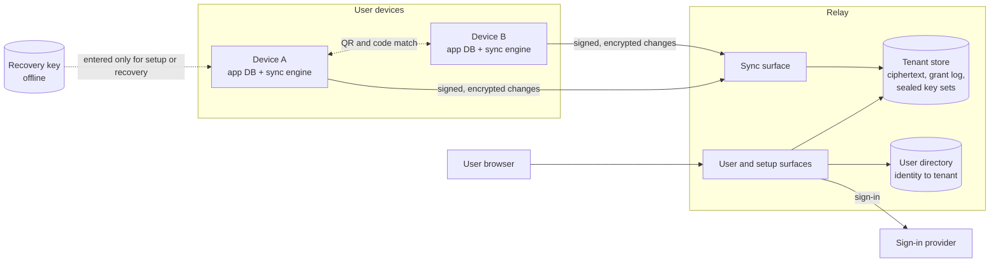

# Design Doc: Snailfish, a Self-Hosted Encrypted Sync Relay

| Field | Value |
| --- | --- |
| Author | Ben |
| Status | Draft |
| Created | 2026-10-21 |
| Updated | 2026-10-21 |
| Name | Snailfish (see Name) |

## Objective

Snailfish is a self-hosted, open-source sync system. Its relay is a service that keeps the data of local-first apps the same on all of one person's devices, and it cannot read that data.

## Name

Snailfish live deeper than any other fish on record, more than 8,000 m down in ocean trenches. App data sinks ("syncs") to the relay, and it stays in the dark there, because the relay cannot read it.

This doc uses "Snailfish" for the whole project and "the relay" for the server.

## Background

The user wants to keep personal data under their own control. Local apps support this, because each device stores the data and needs no service. When the user uses one app on a laptop and a phone, each device holds a separate copy, and the copies drift apart.

Centralised services and web apps keep one copy for all devices. The user then gives the data to the service provider. The app also stops work without an internet connection, or it works with reduced function.

Local-first apps combine the two approaches. Each device keeps a full local database and works offline. A sync service copies changes between devices when a connection is available. For example, a task app syncs tasks, lists, tags, and completion state. Derived data, such as search indexes, stays on each device.

Platform sync, such as Apple CloudKit, ties the data to one vendor. It does not encrypt end to end unless the user turns on Advanced Data Protection. The user also has no control over the server.

Hosted sync vendors, such as Firebase and PowerSync, can read the data that they sync. Each one also adds a vendor account and a price plan.

The relay is a sync service that the relay operator runs and that cannot read the data. Apps integrate through the sync engine, a Rust library with Swift and Python bindings.

## Goals

User outcomes:

1. Keep each app's data the same on all of the user's devices, without manual export or import.
2. Keep every app fully usable offline. Edits that the user makes offline reach the other devices when a connection returns.
3. Keep the data unreadable to the relay operator, the hosting provider, and anyone who gets a copy of the server's storage.
4. Let only devices that the user approves read or write an app's data. Let the user remove a lost or stolen device.
5. Let the user recover all app data on a new device after the loss of every device.

Project outcomes:

6. Let anyone run their own instance from the published source, at a cost that suits one person (target: a free tier or a few pounds a month).
7. Let an app developer add sync to a local-first app through the sync engine, without a change to the app's data model. The app adds only an outbox table and an applied-position record.
8. Tell the user when sync stops (for example a full quota, a stalled device, or a relay that returns wrong history), so that data does not diverge without notice.

## Non-goals

Scope:

1. Each tenant belongs to one user. There is no public signup, and the relay operator approves each user by hand. A relay operator can approve a few users (for example family members), but users share no data.
2. There is no sharing or collaboration between people. Only one person's own devices sync.
3. The relay does not merge data or resolve conflicts. Clients merge with rules that the app defines.
4. The relay does not sync a whole database file. It moves app-defined changes only.
5. The relay does not sync large files or attachments.

Guarantees:

6. The relay does not hide metadata. The relay operator and the hosting provider can see data size, timing, IP addresses, app identifiers, and the device count.
7. The relay is not a backup. It does not guarantee that data survives a malicious or failed relay. The user keeps a separate backup.
8. The relay does not guarantee that a device gets the latest data. A malicious relay can withhold or delay changes, and a device can detect only some of these cases.
9. The design does not give forward secrecy. A removed device keeps all the data and keys that it already holds.

## Missing features

Storage and transport:

1. No log compaction. The relay keeps every change. Storage use grows over time, and a new device downloads the full history on first sync.
2. No real-time push. Devices poll for changes. A change on one device reaches another device only at its next poll.
3. No encrypted export from the relay. The user cannot download an independent backup of the encrypted history. Recovery after relay loss depends on a device that survives.
4. No sync of a part of an app's data. Each device gets all data for each app that it joins.

Security and operations:

5. No group key agreement with post-compromise security (for example MLS). Key rotation occurs only on device removal or recovery.
6. No request traces or detailed request logs. Diagnosis uses aggregate metrics and client-side reports only.
7. No quota edits in the user page. The relay operator sets quotas in configuration. The user can only see usage.
8. No post-quantum key sealing. Key sets use classical X25519. A party that copies relay storage now can open sealed key sets later with a large quantum computer. A new key set record type can add a hybrid KEM after it becomes an RFC.

Client platforms:

9. No sync engine binding for Node, TypeScript, browsers or Android. v1 targets Swift (macOS and iOS) and Python only.

## Scenarios

Sam uses a task app on a laptop and a phone. Sam's friend hosts the relay and approved Sam as a user.

S1. First device. Sam installs the task app on the laptop. The app works at once with no account, and Sam adds tasks offline. Later Sam turns on sync. The app opens a browser sign-in to the relay. The app shows a recovery key once, and Sam writes it on paper. The app then uploads the tasks in encrypted form.

S2. Second device. Sam installs the app on the phone and selects "Add to my account". The phone shows a QR code. Sam scans it with the laptop. Both devices show the same short code, and Sam confirms that the codes match. The laptop approves the phone and sends it the app keys in encrypted form. The phone downloads and decrypts the tasks.

S3. Offline edits. On a flight, Sam completes three tasks on the phone. On the laptop, Sam renames one of the same tasks. After the flight, both devices sync. Both devices show the rename and the three completed tasks. The app's merge rules decide the result, and the relay does not.

S4. Stolen phone. Someone steals Sam's phone. Sam signs in to the user page and selects "Remove" on the phone. The relay blocks the phone at once and pauses writes for the app. Next, the laptop asks Sam to confirm the removal. It then makes a new app key and sends it only to devices that are still trusted. Writes start again. The phone keeps the old data that it already holds, but it cannot read new changes.

S5. All devices lost. A fire destroys the laptop and the phone. Sam buys a new laptop, installs the app, signs in, and enters the paper recovery key. The new laptop gets access to the app, removes the old devices, and makes a new app key. It downloads the full encrypted history and decrypts it with the recovered keys.

S6. Relay returns old data. A storage fault rolls the relay back by one day. On the next sync, the laptop sees that the relay history is older than the history that it verified before. The laptop stops sync and tells Sam. Local tasks stay intact. Sam selects "Restore relay from this device", and the laptop uploads an encrypted copy of its state.

S7. Full quota. Sam reaches the app's storage quota. The relay refuses new changes but continues to serve the stored changes. The sync engine keeps the queued edits in its outbox, and the app shows "Sync paused: storage full". The user page shows usage against the limit.

## User roles

| Action | Relay operator | User (browser sign-in) | Trusted device | Recovery key | Relay |
| --- | --- | --- | --- | --- | --- |
| Approve a new user identity | Yes | No | No | No | No |
| Read app data | No | No | Yes | Yes (after it decrypts the key set) | No |
| Write app data | No | No | Yes | No | No |
| Add the first device to a new app | No | Sign-in required | No | Yes, signs the grant | No |
| Add a later device to an app | No | No | Yes, after QR and code match | No | No |
| Remove a device (block access) | No | Yes | No | No | Enforces |
| Rotate the app key after removal | No | No | Yes | Yes, if no trusted device survives | No |
| See device list and usage | No | Yes | Yes | No | Stores |
| Set quotas | Yes | No | No | No | Enforces |
| Order changes and enforce quotas | No | No | No | No | Yes |

- The relay operator and the user can be the same person, but the roles stay separate.
- User sign-in alone never gives read access, because a stolen session must not expose data.
- The recovery key stays offline. The user enters it only for a first device in a new app, a full recovery, or a key replacement.

## Interfaces

The relay has three surfaces. This section lists operations only. Cryptography lists the crypto primitives.

| Surface | Authentication | Operations |
| --- | --- | --- |
| User | User sign-in in a browser | View apps and devices, remove a device, view usage and quotas |
| Setup | User sign-in plus a device signature, from a native app | Register a first device, recover a lost app, replace the recovery key |
| Sync | Device signature only | Start and finish QR enrollment, append changes, fetch changes from a cursor, fetch grant history, publish a restore snapshot |

### App integration

The host app calls the sync engine through its Swift or Python binding. The engine builds each HTTP request and reads each response. The host app sends the bytes with its own HTTP client. The host app never builds protocol messages, signs requests or verifies history.

```python
engine = Engine.open(data_dir, relay_url, app_id, key_store)

# Push. In one app-database transaction, write the edit and an outbox row.
change_id = engine.new_change_id()
with app_db.transaction():
    app_db.save_edit(edit)
    app_db.outbox_add(change_id, change_bytes)     # the app's own change format, opaque to the engine
for change_id, change_bytes in app_db.outbox():    # after each commit, and at every startup
    engine.enqueue(change_id, change_bytes)        # no effect if the engine already has this change_id
    app_db.outbox_delete(change_id)

# Exchange with the relay.
sync = engine.start_sync()
while (req := sync.next_request()) is not None:    # method, path, headers, body bytes
    resp = httpx.request(req.method, relay_url + req.path, headers=req.headers, content=req.body)
    sync.handle_response(resp.status_code, resp.content)

# Pull. Apply each change and save its position in one app-database transaction.
for change in engine.pending_changes():            # decrypted, verified, in history order
    if change.position > app_db.applied_position(change.generation):  # 0 for a new generation
        with app_db.transaction():
            app.apply(change)                      # the app merges with its own rules
            app_db.set_applied_position(change.generation, change.position)
    engine.ack(change.position)
print(engine.status())                             # for example ok, paused: quota, stopped: rollback, stopped: update required
```

- The engine keeps its sync state in its own SQLite file in `data_dir`: the outbox of encrypted envelopes, the inbox of verified changes, the cursor, the last verified point and the ack point.
- The app keeps two records in its own database: the app outbox, and the applied position (generation and position).

Delivery rules. No transaction covers both the app database and the engine state file. These rules make sure that a crash at any step loses no change and applies no change twice.

- The app writes each edit and its outbox row in the same transaction.
- After each commit and at every startup, the app calls `enqueue` for each outbox row. Then it deletes the row.
- `enqueue` encrypts and signs the change once, and stores the envelope and the `change_id` in one transaction. A second call with a known `change_id` has no effect.
- The engine always sends the stored envelope again on a retry. It never encrypts a change again, because the random nonce gives different bytes, and the relay refuses different bytes for a known `change_id`.
- The engine stores fetched changes in its inbox and moves its verified point forward in one transaction. Inbox entries stay encrypted.
- `pending_changes` returns the changes after the ack point, decrypted. It does not return changes that this device wrote.
- The app applies a change and saves its applied position in one transaction. Then it calls `ack`. The engine deletes inbox entries up to the ack point.
- After a crash before `ack`, the engine returns the same changes again. The app skips each change at or below its applied position.
- The engine ack point can be behind the app applied position, but never ahead of it.
- A restore starts a new generation, and positions start again. The device move to a new generation is part of the restore design (M8).

- `key_store` is an interface that the host app implements. It holds the device private key and the app keys, for example in the Apple Keychain. The Python demo client uses a file.
- The app controls HTTP client settings, TLS, proxies, retry timing and background-task rules.

### Wire format

Requests and responses are UTF-8 JSON over HTTPS. Binary fields use base64. Each signed record (change, grant, checkpoint, enrollment message) travels in an envelope.

Sample signed change, as the relay stores and serves it:

```json
{
  "type": "snailfish.change.v1",
  "key": "d_3fa8...",
  "payload": "<base64 of the exact payload bytes>",
  "sig": "<base64 signature>"
}
```

Sample payload after base64 decoding (illustrative only):

```json
{
  "tenant": "t_7Hq2...",
  "app": "com.example.tasks",
  "generation": "g_91c0...",
  "epoch": 2,
  "change_id": "c_b41e...",
  "ciphertext": "<base64 of opaque bytes>"
}
```

Sample fetch response:

```json
{
  "generation": "g_91c0...",
  "entries": [ { "position": 1041, "envelope": { "...": "..." } } ],
  "cursor": 1041,
  "head_digest": "<hash of history up to position 1041>",
  "has_more": false
}
```

Rules:

- The signature input is a length-prefixed encoding of `type` and the exact payload bytes. The `type` value carries the record kind and the format version, so a signature for one kind is not valid for another kind.
- A verifier checks the signature before it parses the payload.
- The relay and the clients store and forward payload bytes unchanged. Nothing re-encodes a signed payload, so no canonical JSON form is necessary.
- The relay sees the envelope, the payload routing fields and opaque ciphertext only.
- A retry with the same `change_id` and the same bytes returns the original position.
- The same `change_id` with different bytes is a conflict.
- The protocol specification is documentation for audit, diagnosis and other implementations. In v1, the sync engine is the only supported client.

### Versioning

The protocol has its own version numbers. They are separate from the software release versions. These rules apply from the first public release. Before that release, formats can change without notice, the test vectors are regenerated, and development data is deleted.

Signed records:

- The envelope `type` carries the record version, for example `snailfish.change.v1`. A released record type never changes. A change to its fields or algorithms makes a new type, for example `snailfish.change.v2`.
- The record version fixes the algorithms. No field in a record selects an algorithm, so there is no negotiation that an attacker can downgrade.
- The engine parses signed payloads strictly. An unknown field is an error, because an ignored field in a signed record can change its meaning.
- The engine must verify every record version that it ever wrote, for as long as the relay keeps history.
- If the engine finds an unknown record type, it stops sync with the status `stopped: update required`. It never skips the record, because a skipped grant or removal can change the security state.

Rollout:

- An engine release must read a new record version one release before it writes that version.
- The relay operator upgrades the relay before the engines. The relay accepts every record version that it knows.
- Each engine release states the minimum relay version that it needs. The relay shows its supported protocol versions at `GET /v1/info`. If the relay is too old, the engine stops sync with the status `stopped: relay too old`.
- A device that is more than one release behind stops with `stopped: update required`. It fails closed and tells the user.

HTTP API and storage:

- The relay API has a path prefix, for example `/v1/`. A path version accepts only additive changes, for example a new route or a new optional response field.
- The engine parses unsigned response JSON loosely and ignores unknown fields.
- The engine state file and each relay tenant file keep a schema version in SQLite `PRAGMA user_version`. Each file migrates forward when it opens.
- A file with a schema version newer than the software knows does not open. A downgrade then fails with a clear error and does not corrupt the file.
- The engine crate, the bindings and the relay each use their own semver release versions.

The app owns the format of its own data inside the ciphertext. The engine never reads it.

## Diagram



## Glossary

| Term | Meaning |
| --- | --- |
| Relay operator | The person who runs a relay instance and approves users. |
| User | The person whose devices sync. One user has one tenant. |
| Tenant | The separate store for one user's data on the relay. |
| Space | The isolated area for one app inside a tenant. Each app gets one space. A tenant can have many spaces. Devices and keys are separate for each space. |
| Device | One install of one app on one machine, with its own keys. |
| Grant | A signed record that lets a device read and write a space. |
| Grant log | The signed, hash-linked list of grants and removals for a space. |
| Epoch | One generation of an app key. Removal or recovery starts a new epoch. |
| Generation | One version of an app's change history. A restore starts a new generation. |
| Checkpoint | A signed summary of the grant log at a known point. Devices use it to verify later history. |
| Recovery key | A random 128-bit secret that the user keeps offline. Keys derived from it open sealed key sets and sign the first grant of a space. |
| Sync engine | The Rust library, with Swift and Python bindings, that does all client crypto, verification and sync logic. The host app uses it through a binding. |
| Host app | The app that embeds the sync engine. It owns its data, its merge rules and its HTTP client. |
| Envelope | The JSON wrapper for one signed record: type, signing key, exact payload bytes and signature. |
| Applied position | The generation and position of the last remote change that the app applied. The app stores it in its own database. |
| Ack point | The last position that the app confirmed to the engine. The engine deletes inbox entries up to it. |

## Architecture and technology choices

Decided concepts:

| Concern | Choice | Rationale | Swap cost |
| --- | --- | --- | --- |
| Where encryption occurs | Clients encrypt and sign every change. The relay never holds a key. | The relay and its storage must be unreadable (goal 3). | Very high. A change breaks the whole trust model. |
| Relay role | An ordered, append-only log of opaque changes per app. The relay checks signatures, permissions and quotas only. | A relay that cannot read data cannot merge it. A log keeps the relay small. | High. Stored history depends on the log shape. |
| Conflict resolution | Clients merge with app-defined rules. | Only clients see plaintext. Each app knows its own merge semantics. | Low for the relay. It has no merge logic. |
| Tenant isolation | Each user's data lives in a separate store, with no shared tables for app data. | An authorisation bug in one tenant cannot expose another tenant's rows. | Medium. A move to shared storage needs a data migration. |
| Device authority | Each device has its own signing key. A signed, hash-linked grant log per app records which devices can act. Clients verify the log themselves. | The relay can lie about membership, so clients must not trust its word. | Very high. Every device depends on the log format. |
| Device enrollment | A trusted device approves a new device through a QR code and a short code that both devices show. The device whose keys travel through the relay commits to its keys before it sees the nonce of the other device. | User sign-in alone must not add a reader. A copied QR alone must not work. A relay cannot try many keys until a short code matches. | Medium. Only the enrollment flow changes. |
| Recovery | A random recovery key that the user stores offline. Clients seal each app's key set to it. The recovery key also signs the first grant of each space. | Recovery works without key escrow on the relay. | High. Stored key sets depend on it. |
| Device removal | The relay blocks the device at once. A trusted device then makes a new app key. | A block alone leaves the old key valid. The relay cannot rotate a key that it does not hold. | Medium. |
| History integrity | A hash-linked history per app with a random generation ID. Each device stores the last verified point. | Devices detect rollback, forks and gaps from a faulty or malicious relay. | High. It is part of the stored format. |
| Transport | HTTPS request and response with polls. No persistent connections. | Phones sync at intervals. Polls keep no idle connection state. | Low. Push can come later as a hint. |
| User page | The relay serves it behind user sign-in. | One deployable unit is easier to self-host. | Low. |
| Metrics and alerts | Metrics in Prometheus or OpenMetrics format. Alerts go to a configured webhook URL (for example ntfy, Slack or an email gateway). | Self-hosters use their own stack. The relay holds no delivery logic or mail credentials. | Low. Both are standard interfaces. |
| Relay deployment | One static Rust binary, shipped as a container image. It runs on a small VPS or a home server. One process serves all tenants of an instance. The data directory must be on a local disk. | Anyone can run it on any host for a few pounds a month (goal 6). The SLOs need no edge distribution or cluster. SQLite is not safe on a network file system. | Medium. A managed platform needs a new storage layer. |
| Relay language | Rust, with axum and tokio for HTTP and rusqlite for storage. It builds as a static musl binary. | The relay and the sync engine use the same `protocol` crate. A second implementation of the verification rules can drift and make the relay accept records that clients refuse. | High. A new language means a rewrite of the relay. |
| Code layout | One Cargo workspace with four crates. `protocol`: record types, envelopes, signature input, verification, history digests and grant log state, with no I/O. `engine`: `protocol` plus the sync state machine and its SQLite state. `bindings`: the UniFFI Swift and Python bindings. `relay`: `protocol` plus HTTP and tenant storage. The published names have a `snailfish-` prefix, for example `snailfish-engine`. The Python package is `snailfish` and the Swift module is `Snailfish`. | The relay and the engine apply the same rules from the same code. `protocol` does no I/O, so both a synchronous engine and an async relay can use it. | Medium. |
| Relay storage | One SQLite database file per tenant. | One SQLite transaction covers the permission check, the quota check and the append. A separate file per tenant gives tenant isolation. One process with one write transaction per file gives one writer at a time. | Medium. A new engine needs a data migration. |
| User directory | A separate SQLite database file. It holds only the approved identity-to-tenant mapping and status. | The directory stays apart from app data, keys and grants. | Low. |
| Wire encoding | UTF-8 JSON over HTTPS. Each signed record is an envelope that carries the exact payload bytes. Signatures cover the type and those bytes. | JSON is easy to read and debug, and every target language supports it. A signature over exact bytes needs no canonical form. | High. Stored records use the envelope. |
| Versioning | Protocol versions are separate from release versions. Released record types never change, and the record version fixes the algorithms. Old engines fail closed. Databases migrate forward only. See Versioning. | No algorithm negotiation to downgrade. A device never skips a record that it cannot verify. | High after the first public release. Released formats stay readable for the life of the history. |
| Delivery | A transactional outbox in the app database for push. Acknowledged delivery from an engine inbox for pull, with the applied position in the app database. See Delivery rules. | No transaction covers two SQLite files. The app records only what makes a retry safe, so app merges need not be idempotent. | Medium. It changes the integration API. |
| Sync engine | One Rust crate, on top of `protocol`, holds all client crypto, history verification, grant log logic and sync logic. It is a synchronous state machine with no network I/O: it builds each request and reads each response, and the host app sends the bytes. It keeps its sync state in its own SQLite file. The host app holds the device private key and the app keys through a key store interface. | One implementation of the security-critical code and the sync logic for every platform. No network I/O means no async across the binding layer. Local SQLite access is synchronous. | High. Every binding depends on it. |
| Engine bindings | UniFFI generates the Swift and Python bindings from the sync engine. Swift for macOS and iOS is the first app platform. The Python binding drives the demo client and the end-to-end tests. | UniFFI supports Swift and Python directly, and Mozilla uses it in production. One tool covers both targets. Python tests run in Linux CI without a simulator. | Medium. A switch to PyO3 for Python changes only the Python binding. |

Crypto boundary. The sync engine does all security-critical crypto. The relay only verifies and hashes.

| Operation | Sync engine | Relay |
| --- | --- | --- |
| Generate device keys, app keys and the recovery key | Yes | No |
| Encrypt and decrypt changes | Yes | No |
| Seal and open key sets | Yes | No |
| Sign changes, grants, checkpoints and requests | Yes | No |
| Verify signatures on changes, grants and requests | Yes | Yes, to enforce permissions and refuse unknown keys |
| Verify the grant log and history digests | Yes. The client result is authoritative. | Computes digests. Clients do not trust them. |
| Hold server secrets for sessions, anti-CSRF tokens and tenant handles | No | Yes. None of these secrets decrypts app data. |

- A relay bug can break availability or permission checks. It cannot expose app content, because the relay holds no data key.
- The relay and the sync engine verify signatures, history digests and grant log state with the same `protocol` crate. The relay never uses the encryption or key-sealing code.
- The shared test vectors run against the sync engine, each binding and the relay, so a binding bug or a relay bug fails CI.

Cryptography. The `protocol` and `engine` crates use these primitives. The record version fixes them (see Versioning).

| Use | Primitive | Rust crate |
| --- | --- | --- |
| Signatures on records, requests, grants and checkpoints | Ed25519. Verification uses `verify_strict`, which refuses small-order and non-canonical points. | `ed25519-dalek` |
| History digests, body digests and device IDs | SHA-256 | `sha2` |
| Change encryption | XChaCha20-Poly1305, with a random 24-byte nonce for each change | `chacha20poly1305` |
| Key derivation | HKDF-SHA256 | `hkdf` |
| Key sealing to devices and to the recovery key | HPKE (RFC 9180) base mode with DHKEM(X25519, HKDF-SHA256), HKDF-SHA256 and ChaCha20Poly1305 | `hpke` |
| Randomness | The operating system CSPRNG | `getrandom` |

Rules:

- Each device has a separate Ed25519 signing key and X25519 sealing key. The grant holds both public keys. The design never converts an Ed25519 key to an X25519 key.
- The device ID is the SHA-256 hash of the two device public keys, so an ID cannot name a different key.
- The recovery key is 128 random bits. The user sees it as Crockford base32 with a checksum. HKDF derives an X25519 sealing key and an Ed25519 signing key from it.
- Many devices encrypt with one app key and share no counter. Each change therefore uses a random 192-bit nonce.
- Each signature input, HKDF `info` value, HPKE `info` value and AEAD associated data starts with a versioned type string, for example `snailfish.change.v1`.
- The AEAD associated data of a change holds the tenant, app, epoch and `change_id`. A relay cannot present a ciphertext with other routing fields.

Audit status:

- `ed25519-dalek`, `x25519-dalek` and `curve25519-dalek` received a Quarkslab audit in 2019.
- `chacha20poly1305` received an NCC Group audit in 2020, with no significant findings.
- `hpke` has no paid audit. Cloudflare reviewed version 0.8. It uses the audited primitive crates above.
- CI checks `hpke` against the RFC 9180 test vectors. A separate test harness also checks it against the Go standard library `crypto/hpke`.
- The audits covered earlier versions than the versions in use.

The shared test vectors also include the Ed25519 edge cases from the C2SP CCTV set, so the strict verification behaviour is recorded.

Open choices. Each row states a constraint that any choice must meet. Open issues track the decisions.

| Concern | Status | Constraint on the choice |
| --- | --- | --- |
| User sign-in | Open | Must give a stable, exact user identity for a relay operator allowlist. Email never selects a tenant. The relay does not store passwords. |

## SLOs

Apps work offline, so relay downtime only delays sync.

Scale:

- 1 to 5 users per instance. 1 to 10 apps per user. 2 to 10 devices per app.
- The relay sets fixed upper limits for change size, request size and stored bytes per tenant. Each self-hoster selects the values. The design does not fix them.
- Load: under 10,000 requests per day per instance.

Service:

- Availability: 99% per month (about 7 hours of outage a month). An outage delays sync and loses no data, because devices keep queued edits.
- Append latency: p95 under 1 second.
- Propagation: a change reaches another online device within one poll interval (default 1 minute in the foreground).
- First sync of a new device: 10,000 changes in under 2 minutes.
- Durability: the relay targets no data-loss SLO. Devices that survive are the source for restoration.

These numbers justify one small process and an embedded database per tenant, with no queue, cache or cluster.

## Monitoring and alerting

The relay cannot see content, so every signal is aggregate or per device.

Relay operator signals:

1. An external liveness check runs every 5 minutes against an unauthenticated health route. It alerts after 3 failures in a row.
2. The relay counts requests, 4xx and 5xx responses, signature failures, authentication denials and quota denials per hour. It alerts if 5xx responses exceed 5% for 15 minutes.
3. The relay tracks storage per tenant against its limit. It alerts the relay operator at 80% and 95%.
4. The relay alerts on every storage-layer error and every failed schema migration.

User signals, on the user page:

5. The page shows the last-seen time for each device. It marks a device as stalled after 7 days without a fetch.
6. The page shows usage against quota for each app, with a warning at 80%.
7. The page shows open security actions, for example a removal that waits for a trusted device to rotate the key, or paused writes.

Client-detected failures:

8. Only devices can detect rollback, forks, gaps and bad signatures, because only devices verify history. The sync engine reports these failures to the host app in the sync status, together with `stopped: update required` and `stopped: relay too old`, and the app shows them to the user. The relay never receives a report with content.

Metrics hold no tenant, device or app identifiers. The exceptions are the user's own view and the per-tenant storage figure for the relay operator.

## Security

T1. The relay operator, the hosting provider, or a thief copies the relay storage.

- The storage holds only ciphertext, public keys, signed records and sealed key sets.
- No key that decrypts app data exists on the relay.
- Limit: key sets use classical X25519 sealing. A party that keeps a copy now can open them later with a large quantum computer (Missing feature 8).

T2. An attacker steals the user's sign-in session or sign-in account.

- The attacker can see the device list and usage, and can remove devices.
- Sign-in alone cannot add a device to a space that has devices, and it cannot decrypt data.
- The user can undo a removal. The user adds devices again through a trusted device or the recovery key.

T3. An attacker gets an approved identity at a different identity provider, or an email address that matches the user's address.

- The relay selects a tenant only from the exact identity on the relay operator allowlist. Email never selects a tenant.
- There is no public signup route.

T4. Cross-site request forgery against the user page.

- Every user write requires an exact Origin match and an anti-CSRF token bound to the session.
- Device routes reject cookies and accept only device signatures.

T5. An attacker replays a captured device request.

- Each request signature covers method, path, body digest, expiry and a one-use nonce.
- The relay rejects an expired request or a reused nonce.

T6. An attacker photographs or copies a QR enrollment code.

- The QR holds only public keys and a session ID, and no secret.
- The trusted device sends keys only after the user confirms that both devices show the same short code.
- The device whose keys travel through the relay commits to its public keys and a random nonce before it receives the nonce of the other device. The short code comes from both public keys and both nonces. A relay that substitutes keys therefore gets one guess for each enrollment session.
- Each enrollment session works once and expires within minutes.

T7. A malicious or faulty relay rolls back, forks, reorders or drops history.

- Each device stores the last verified generation, position and history digest, and stops sync on a mismatch.
- Clients verify the grant log themselves, so the relay cannot add a device.
- Limit: a relay can still withhold or delay changes. A new device with no stored point cannot detect every fork (Open issue 3).

T8. A device is lost or stolen.

- The user removes it. The relay blocks it at once and pauses writes for that app.
- A trusted device makes a new app key and seals it only to the devices that stay in the app.
- Limit: the removed device keeps the data and keys that it already holds. There is no forward secrecy for old changes.

T9. An attacker steals the recovery key.

- The attacker can decrypt every app key set sealed to it.
- The user replaces the recovery key and rotates the current app keys. Old ciphertext copies stay readable to the attacker.

T10. A device or attacker uploads malformed or oversized changes, or a flood of changes.

- The relay checks size limits and signatures before storage, and quotas inside the same transaction as the append.
- A refused change modifies no stored state.
- The relay reserves separate capacity for security records, so a full quota cannot block a device removal or recovery.

T11. An attacker guesses or forges a tenant identifier to reach the storage of another tenant.

- The relay routes requests only through a server-signed tenant handle or the user directory, and never through a raw tenant ID from the caller.

T12. Server-side injection into app data does not apply. The relay never parses or queries app content.

## Privacy

| Data | Devices | Relay and relay operator | Hosting provider |
| --- | --- | --- | --- |
| App content | Yes | No (ciphertext only) | No |
| App keys, device private keys, recovery key | Yes (own keys) | No | No |
| User identity | No | Yes | Yes |
| App identifiers, device list, public keys | Yes | Yes | Yes |
| Change size, timing, IP addresses | No | Yes | Yes |

The relay stores the minimum plaintext that routing, the device list, expiry and quotas need.

## Data retention

- The relay keeps every change and signed record for the life of the tenant. There is no automatic deletion.
- The user can delete one space or the whole tenant. Deletion removes the relay copy only. Devices keep their local data.
- Relay backups are the relay operator's choice. A backup holds only ciphertext and public metadata.
- A removed device stays in the grant log as a removed entry, because devices must still verify history.

## Logging

- By default, the relay writes no request logs. Logs hold only aggregate counts and error classes.
- The relay must never log secrets, tokens, request bodies, signatures, QR payloads, recovery proofs, full URLs, user identities, IP addresses, or tenant, app or device identifiers.
- Each new log field needs a review against this list first.
- Logs stay on the relay operator's machine. The relay operator sets retention (suggested: 14 days).

## Licensing

The project uses two licences:

- The `relay` crate uses AGPL-3.0. A party that runs a modified relay as a network service must publish its changes. This rule stops closed hosted forks of a privacy tool. Some companies avoid AGPL code, and the project accepts that cost.
- The `protocol`, `engine` and `bindings` crates use MIT OR Apache-2.0. Apps embed the sync engine, and an AGPL engine would put AGPL terms on every app (goal 7).

The relay can depend on the permissive crates. The permissive crates must never depend on the `relay` crate.

## Milestones

The milestones follow ROI order: a verified protocol and toolchain come first, then sync that works, then the protections that make it safe to trust, then multi-user support and operations. Each milestone is demoable.

The demo client is a Python CLI on the Python binding. It uses the integration loop from App integration with `httpx`, so it is also the reference integration. Each device is a separate data directory with its own app database, engine state file and key file, so two devices can run on one machine. An agent or CI can run every demo without a phone, a simulator or a camera. The demo app is a small task list with last-writer-wins merge rules for each field.

1. M1: protocol and toolchain. The scope is the shared test vectors for the primitives in Cryptography (including the RFC 9180 vectors and the Ed25519 edge cases), a skeleton sync engine, and UniFFI builds for Python and Swift. Demo: the same test vectors pass in the `protocol` crate, the sync engine, the relay, the Python binding, and the Swift binding on an iOS simulator.
2. M2: two devices sync, with one hard-coded user. The scope is one user, one app, and a key shared by hand, with encrypted append and fetch, a fixed order, and exact retries. The relay uses the final storage design (one SQLite file per tenant) and stores each change in the final format, with generation, position and history digest. The relay ships as a container image with a health route. Demo: a script edits a task on device A, syncs both devices, and device B shows the edit. The relay storage holds only ciphertext. A crash test stops the demo client at each step of push and pull, and no change is lost or applied twice.
3. M3: history integrity. The scope is the client checks on the stored history. Devices store the last verified point and stop on rollback or fork. Demo: the relay operator restores an old relay copy, and the device refuses it.
4. M4: device authority. The scope is a signed grant log per app, the recovery key, and enrollment of a second device. The recovery key signs the first grant, so the root of the grant log does not change in later milestones. The new device gets a signed checkpoint during enrollment (Open issue 3). Enrollment uses the commit before reveal step (T6). In the demo client, the QR payload is a text string, and the short-code match is a prompt with a non-interactive flag for tests. Demo: device B joins through the text payload and a code match, and the relay refuses an unknown key. A test relay that substitutes keys causes a code mismatch.
5. M5: Swift sample app. The scope is a SwiftUI version of the demo app on macOS and iOS, with real QR scans. Demo: an iPhone joins through a QR scan from a Mac, and edits sync both ways.
6. M6: user sign-in and the user page. The scope is a decision on Open issue 1, a user allowlist, tenant isolation, the device list, usage and quotas. Demo: a second user on the same instance cannot reach the first user's tenant.
7. M7: removal and recovery. The scope is device removal with key rotation, full recovery onto a new device, and the reserved capacity for security records (T10). Demo: scenarios S4 and S5.

From M3 to M7, a device that detects rollback or a fork stops sync but cannot repair the relay. This is acceptable, because no user depends on the relay before M8.

After M7:

8. M8: restore from a device, monitoring, alerts, and self-host packages. The scope includes a published Python package. Demo: scenario S6, an alert from a full quota, and a fresh install from the published docs.

## Open issues

Protocol:

1. User sign-in mechanism. Options: OIDC with any provider, passkeys that the relay serves, or an identity layer in a reverse proxy in front of the relay. Next step: compare the effort for a self-hoster and the stability of the identity value.
2. History growth. There is no log compaction in v1. Option: signed client snapshots with a policy for stale devices. Next step: measure growth after M2.
3. Fork detection for a new device. A new device has no stored point, so it cannot detect every fork. Option: the new device gets a signed checkpoint from a trusted device during QR enrollment. The enrollment design must include the commit before reveal step (T6). Next step: design with M4.

## Closed issues

Data model:

- C1. Does the relay merge data, or do clients merge? Clients. A relay that merges must read plaintext, which breaks goal 3.
- C2. Replicate the database file, or sync app-defined changes? Changes. File replication ties the relay to one database engine and forces apps to change their schema. It also sends derived data that each device can rebuild.
- C3. One shared store with a tenant column, or one store per tenant? One per tenant. A missed tenant filter in a shared store exposes the data of other users.
- C4. Trust the relay's own generation counter to detect rollback? No. A relay that rolls back its data also rolls back the counter. Devices keep their own verified point.

Keys and devices:

- C5. Can user sign-in add a device to a space that has devices? No. A stolen session then gives read access. Only a trusted device or the recovery key can add a device.
- C6. Put a short secret in the QR code? No. A copied QR then acts as the new device. The QR holds public keys only, and the user compares a short code.
- C7. Escrow keys on the relay for easy recovery? No. The user keeps an offline recovery key, and the relay stores only sealed key sets.
- C8. Remove a device without a key change? No. The removed device still knows the current key, so a trusted device must rotate it.
- C9. Use a group key agreement protocol (for example MLS) now? No. It adds protocol and client complexity before the first sync that works. It stays in Missing features.

Operations:

- C10. Persistent connections for live updates? No. Polls suit intermittent phone use and keep no idle connection state.
- C11. Licence? AGPL-3.0 for the relay, so a hosted fork of a privacy tool must publish its changes. MIT OR Apache-2.0 for `protocol`, `engine` and `bindings`, so apps can embed the sync engine under any licence.
- C12. Alert delivery? Prometheus or OpenMetrics metrics and a webhook URL. Built-in SMTP adds credentials and delivery logic to the relay. A user page alone lets a stalled device or a full quota go unnoticed.

Platform:

- C13. Where does the relay run? As one static binary in a container, on a small VPS or a home server. Any self-hoster can run it on any host, and the SLOs need no more.
- C14. Support a managed edge platform (for example Cloudflare Durable Objects) in v1? No. It ties every self-hoster to one vendor and needs a second storage layer.
- C15. Relay language? Rust. The relay shares the `protocol` crate with the sync engine, so envelope parsing, request signatures, history digests, grant log state and signature strictness have one implementation. Go has a simpler server model, but a second implementation of these rules can drift from the engine.
- C16. Relay storage? One SQLite file per tenant, and a separate SQLite file for the user directory. One transaction covers checks and the append, and separate files isolate tenants.
- C17. Client library strategy? One Rust sync engine with UniFFI bindings for Swift and Python. Swift for macOS and iOS is the first app platform, and Python drives the demo client and tests. One implementation of the client crypto removes a class of cross-platform bugs.
- C18. Use napi-rs or wasm-bindgen for Node and browsers in v1? No. No v1 app needs them. UniFFI has no mature Node support, so they need a second binding tool. They stay in Missing features.
- C19. First demo client? A Python CLI, not a phone app. An agent or CI can run two devices on one machine with no simulator or camera.

Protocol:

- C20. Wire encoding? UTF-8 JSON over HTTPS, with signed records in envelopes of exact payload bytes. CBOR and Protocol Buffers save little at this scale and make traffic harder to read. A signature over a re-encoded structure needs a canonical form, which is a common source of bugs.
- C21. Does the host app build protocol messages itself, or does a separate transport library do it? Neither. The sync engine builds every request and reads every response, and the host app only sends bytes. Almost every message needs signatures or verification, and sync logic errors cause silent divergence (goal 8).
- C22. Where does the engine keep its sync state? In its own SQLite file in a directory that the host app gives it. If every app saves engine state itself, every app must get crash safety right.
- C23. Versioning policy? Frozen record types, algorithms fixed by the record version, fail closed on an unknown type, read one release before write, relay first, forward-only migrations. The rules start at the first public release. A device that is two releases behind stops sync until it updates. Per-device version records in the grant log add work for little gain at this scale.
- C24. How do the app database and the engine state stay consistent after a crash? A transactional outbox for push and acknowledged delivery for pull. The engine cannot write the app database without a tie to its storage engine. A rule that every merge is idempotent fails for changes such as counter increments. Goal 7 permits an outbox table and an applied-position record in the app database.
- C25. Crypto primitives? Ed25519, SHA-256, XChaCha20-Poly1305, HKDF-SHA256 and HPKE with X25519. They are standard, they have audited Rust crates, and a random nonce is safe for many devices that share one key.
- C26. Use the `hpke` crate without a paid audit? Yes. It uses audited primitive crates, and CI checks it against the RFC 9180 vectors and Go `crypto/hpke`. Cryspen `hpke-rs` had published vulnerabilities in 2026, including nonce reuse.
- C27. Post-quantum key sealing in v1? No. X-Wing and the other hybrid KEMs are still Internet-Drafts, and released formats never change. A new key set type can add a hybrid KEM after it becomes an RFC.
- C28. Is a short code alone enough for enrollment? No. A relay can try many keys until a 6-digit code matches. A commit before reveal step leaves one guess for each session.
- C29. Project name? Snailfish. The bare name is free on PyPI and crates.io, and the only clash found is Advent of Code puzzle solutions. Olm, the blind cave salamander, is the Matrix encryption library, so it would cause confusion.

## Alternatives considered

Products and approaches that do not fit the threat model:

- Do nothing, and use each app on one device only. The user works across a laptop and a phone, so this fails goal 1.
- Apple CloudKit. It ties the data to one vendor, encrypts end to end only with Advanced Data Protection, and gives no control over the server.
- Firebase, PowerSync, ElectricSQL. They read plaintext. Most add a vendor account and a central database as the source of truth.
- Syncthing, or file sync of the database. Whole-file sync of a live database causes conflicts and corruption. It also has no app-level merge.

End-to-end encrypted projects with a different scope:

- Evolu. It gives end-to-end encrypted SQLite sync through blind relays. It is tied to one language runtime and has no signed device authorisation model.
- Standard Notes. It is end-to-end encrypted and self-hostable, but it is tied to one app and its item model.
- any-sync (Anytype). It is encrypted, with signed history and permissions. It uses a peer-to-peer model and a large protocol stack.
- Secsync. It defines an architecture for encrypted CRDT updates through a central relay. It leaves key exchange, rotation and device authority out of scope.
