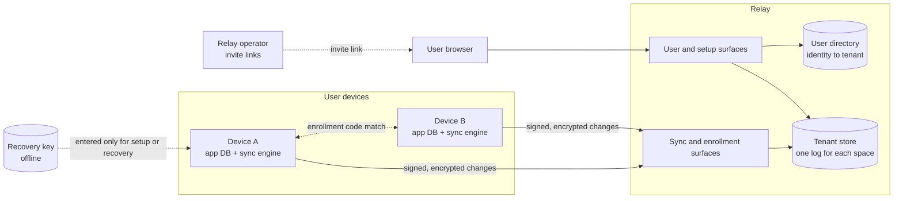

# Design Doc: Snailfish, a Self-Hosted Encrypted Sync Relay

| Field | Value |
| --- | --- |
| Author | Ben |
| Status | Draft |
| Created | 2026-10-21 |
| Updated | 2026-10-22 |
| Name | Snailfish (see Name) |

## Objective

Snailfish is a self-hosted, open-source sync system. Its relay is a service that keeps the data of local-first apps the same on all of one person's devices, and it cannot read that data.

## Name

Snailfish live deeper than any other fish on record, more than 8,000 m down in ocean trenches. App data sinks ("syncs") to the relay, and it stays in the dark there, because the relay cannot read it.

This doc uses "Snailfish" for the whole project and "the relay" for the server.

## Background

The user wants to keep personal data under their own control. Local apps support this, because each device stores the data and needs no service. When the user uses one app on a laptop and a phone, each device holds a separate copy, and the copies drift apart.

Centralised services and web apps keep one copy for all devices. The user then gives the data to the service provider. The app also stops work without an internet connection, or it works with reduced function.

Local-first apps combine the two approaches. Each device keeps a full local database and works offline. A sync service copies changes between devices when a connection is available. For example, a task app syncs tasks, lists, tags, and completion state. Derived data, such as search indexes, stays on each device.

Platform sync, such as Apple CloudKit, ties the data to one vendor. It does not encrypt end to end unless the user turns on Advanced Data Protection. The user also has no control over the server.

Hosted sync services, such as Firebase and PowerSync Cloud, can read the data that they sync, and each one adds a vendor account and a price plan. Self-hosted sync servers, such as PowerSync Open Edition, keep the data in plaintext on the server.

The relay is a sync service that the relay operator runs and that cannot read the data. Apps integrate through the sync engine, a Rust library with Swift and Python bindings.

## Goals

User outcomes:

1. Keep each app's data the same on all of the user's devices, without manual export or import.
2. Keep every app fully usable offline. Edits that the user makes offline reach the other devices when a connection returns.
3. Keep the data unreadable to the relay operator, the hosting provider, and anyone who gets a copy of the server's storage.
4. Let only devices that the user approves read or write an app's data. Let the user remove a lost or stolen device.
5. Let the user recover app data on a new device after the loss of every device. Recovery covers each change that the relay stored, if the relay or an encrypted export survives.

Project outcomes:

6. Let anyone run their own instance from the published source, at a cost that suits one person (target: a free tier or a few pounds a month).
7. Let an app developer add sync to a local-first app through the sync engine, without a change to the app's data model. The app adds an outbox table and an applied-position record, and its merge rules must meet the merge contract (see App integration).
8. Tell the user when sync stops (for example a full quota, a stalled device, or a relay that returns a wrong log), so that data does not diverge without notice.

## Non-goals

Scope:

1. Each tenant belongs to one user. There is no public signup, and the relay operator approves each user by hand. A relay operator can approve a few users (for example family members), but users share no data.
2. There is no sharing or collaboration between people. Only one person's own devices sync.
3. The relay does not merge data or resolve conflicts. Clients merge with rules that the app defines.
4. The relay does not sync a whole database file. It moves app-defined changes only.
5. The relay does not sync large files or attachments.

Guarantees:

6. The relay does not hide metadata. The relay operator and the hosting provider can see data size, timing, IP addresses, app identifiers, and the device count.
7. The relay is not a backup. It does not guarantee that data survives a malicious or failed relay. The user keeps a separate backup, for example an encrypted export (see Data retention).
8. The relay does not guarantee that a device gets the latest data. A malicious relay can withhold or delay changes, and a device can detect only some of these cases.
9. The design does not give forward secrecy. A removed device keeps all the data and keys that it already holds.

## Missing features

Storage and transport:

1. No compaction of security records. Grants, epoch records and recovery records stay in full for the life of the space.
2. No real-time push. Devices poll for changes. A change on one device reaches another device only at its next poll. On iOS, the system decides when a background app runs, so a phone in the background can get a change hours late. The app syncs when it opens. A push hint can come later as an additive route.
3. No automatic repair of a fork. The devices stop sync and report the fork, and the user repairs it by hand from one device (see Fork repair). A rollback without a fork has an automatic repair (S6).
4. No sync of a part of an app's data. Each device gets all data for each app that it joins.

Security and operations:

5. No group key agreement with post-compromise security (for example MLS). Key rotation occurs only on device removal or recovery.
6. No request traces or detailed request logs. Diagnosis uses aggregate metrics and client-side reports only.
7. No quota edits in the user page. The relay operator sets quotas in configuration. The user can only see usage.
8. No post-quantum key sealing. Key sets use classical X25519. A party that copies relay storage now can open sealed key sets later with a large quantum computer. A new key set record type can add a hybrid KEM after it becomes an RFC.

Client platforms:

9. No sync engine binding for Node, TypeScript, browsers or Android. v1 targets Swift (macOS and iOS) and Python only.

## Scenarios

Sam uses a task app on a laptop and a phone. Sam's friend hosts the relay, created a user for Sam, and sent Sam an invite link. Sam opened the link and registered a passkey.

S1. First device. Sam installs the task app on the laptop. The app works at once with no account, and Sam adds tasks offline. Later Sam turns on sync. The app opens a browser sign-in to the relay, and Sam signs in with the passkey. The app shows a recovery key for the task app once. Sam writes it on paper and types it back, and the app checks the copy. The app then uploads the tasks in encrypted form.

S2. Second device. Sam installs the app on the phone and selects "Add to my account". The laptop shows a QR code, and Sam scans it with the phone. A device without a camera can show the QR code, or the user can type a session code. Both devices show the same 6-digit code, and Sam confirms the match on both devices. The laptop appends a grant with the app keys sealed to the phone, and sends the phone a signed checkpoint. The phone checks the log up to the checkpoint, and then it downloads and decrypts the tasks.

S3. Offline edits. On a flight, Sam completes three tasks on the phone. On the laptop, Sam renames one of the same tasks. After the flight, both devices sync. Both devices show the rename and the three completed tasks. The app's merge rules decide the result, and the relay does not.

S4. Stolen phone. Someone steals Sam's phone. Sam signs in to the user page and selects "Block this machine" on the phone. The relay refuses requests at once from every device with the machine label of the phone, in every app. Next, the laptop shows the devices that stay, and Sam confirms the list. The laptop signs the removal, makes a new app key, and seals it only to the devices on the list. The phone keeps the old data that it already holds, but it cannot read new changes.

S5. All devices lost. A fire destroys the laptop and the phone. Sam buys a new laptop, installs the app, signs in with the synced passkey, and enters the paper recovery key. If Sam has no passkey left, the relay operator sends Sam a new invite link. The new laptop gets access to the app, removes the old devices, and makes a new app key. It downloads the latest snapshot, the security records and the later changes, and decrypts them with the recovered keys. Edits that never reached the relay are lost.

S6. Relay returns old data. A storage fault rolls the relay back by one day. On the next sync, the laptop sees that the relay log ends before the position that the laptop verified. The laptop uploads the lost records again, with the same bytes at the same positions. The other devices then sync as normal, and the app tells Sam about the repair.

S7. Full quota. Sam reaches the app's storage quota. The relay refuses new changes but continues to serve the stored changes. The sync engine keeps the queued edits in its outbox, and the app shows "Sync paused: storage full". The user page shows usage against the limit. The next snapshot replaces older changes with stubs, so usage drops. If that is not enough, Sam asks the relay operator for a larger quota.

## User roles

| Action | Relay operator | User (browser sign-in) | Trusted device | Recovery key | Relay |
| --- | --- | --- | --- | --- | --- |
| Create a user and send an invite link | Yes | No | No | No | No |
| Read app data | No | No | Yes | Yes, after it opens the key sets | No |
| Write app data | No | No | Yes | No | No |
| Add the first device to a new app | No | Sign-in required | No | Yes, signs the genesis record, which holds the first grant | No |
| Add a later device to an app | No | No | Yes, after the code match on both devices | Yes, in a full recovery | No |
| Block or unblock a device | No | Yes | No | No | Enforces |
| Remove a device and rotate the app key | No | No | Yes, after the user confirms the devices that stay | Yes, if no trusted device survives | Enforces |
| Replace the recovery key | No | Sign-in required | Yes, appends the record | Yes, the current and the new key both sign | No |
| See device list and usage | No | Yes | Yes | No | Stores |
| Set quotas | Yes | No | No | No | Enforces |
| Order records and enforce quotas | No | No | No | No | Yes |

- The relay operator and the user can be the same person, but the roles stay separate.
- User sign-in alone never gives read access, because a stolen session must not expose data.
- A block is reversible and affects availability only. A removal is a signed log record, and it is final. The relay refuses every request from a removed device, and an unblock does not change that.
- The recovery key stays offline. The user enters it only for a first device in a new app, a full recovery, or a key replacement.
- Each space has its own recovery key, so an app never receives the recovery key of another app (T13).

## Interfaces

The relay has four surfaces. This section lists operations only. Cryptography lists the crypto primitives.

| Surface | Authentication | Operations |
| --- | --- | --- |
| User | Passkey sign-in in a browser | View spaces and devices, block or unblock a device, block all devices with one machine label, view usage, quotas and device status |
| Setup | A setup token from passkey sign-in, plus a device signature, from a native app | Create a space, recover a space, get a tenant handle |
| Sync | Device signature only | Append records, fetch records from a position, upload lost records again, bind an enrollment session, report and fetch device status |
| Enrollment | None. The relay limits the rate for each IP address. | Open an enrollment session, exchange enrollment messages |

User sign-in uses passkeys (WebAuthn) that the relay serves, with the `webauthn-rs` crate.

- The relay operator creates each user with a command, for example `snailfish-relay user add sam`. The command prints a one-time invite link that expires after 7 days.
- The user opens the link and registers a passkey. The user can register more passkeys later on the user page.
- The relay assigns each user a random user ID. The user directory maps the user ID to the tenant and to the passkey credentials.
- If the user loses every passkey, the relay operator makes a new invite link. The new link removes the old passkeys of that user.
- The WebAuthn relying party ID is the relay domain. The relay needs a stable HTTPS domain, for example a Tailscale `ts.net` name, because a passkey works only on its domain.

The native app gets a setup token through the system browser (`ASWebAuthenticationSession` on Apple platforms). The flow uses an authorization code with PKCE, as RFC 8252 requires for native apps. The relay binds the setup token to the device public keys, and the token expires after 10 minutes.

### App integration

The host app calls the sync engine through its Swift or Python binding. The engine builds each HTTP request and reads each response. The host app sends the bytes with its own HTTP client. The host app never builds protocol messages, signs requests or verifies the log.

```python
engine = Engine.open(data_dir, relay_url, space_id, key_store)  # locks data_dir: one engine per directory

# Push. In one durable app-database transaction, apply the edit and write an outbox row.
change_id = engine.new_change_id()                 # 128 random bits
with app_db.transaction():
    app.apply_edit(edit)
    app_db.outbox_add(change_id, change_bytes)     # the app's own change format, opaque to the engine
for change_id, change_bytes in app_db.outbox():    # after each commit, and at every startup
    engine.enqueue(change_id, change_bytes)        # durable before it returns. No effect if already known.

# Exchange with the relay.
sync = engine.start_sync()
while (req := sync.next_request()) is not None:    # method, URL, headers, body bytes
    resp = httpx.request(req.method, req.url, headers=req.headers, content=req.body, follow_redirects=False)
    sync.handle_response(resp.status_code, resp.headers, resp.content)

# Pull. The engine keeps the log, so the app asks for the changes after its own applied position.
for change in engine.changes_after(app_db.applied_position()):  # decrypted and verified, in log order
    with app_db.transaction():
        if change.position <= app_db.applied_position().position:
            continue                               # the check is inside the transaction
        if app_db.outbox_has(change.change_id):
            app_db.outbox_delete(change.change_id) # an own edit: the app applied it at edit time
        else:
            app.apply(change.change_bytes)         # the app merges with its own rules
        app_db.set_applied_position(change.position, change.digest)
print(engine.status())                             # for example ok, degraded, paused: quota, stopped: fork
```

- The engine keeps its state in its own SQLite file in `data_dir`: the outbox of encrypted envelopes and the verified log.
- The app keeps two records in its own database: the app outbox, and the applied position (log position and log digest).
- `key_store` is an interface that the host app implements. It holds the device private keys and the app keys. The Swift binding uses the Keychain with `kSecAttrAccessibleAfterFirstUnlockThisDeviceOnly`, so a backup or a migration does not copy the keys to another machine. The Python demo client uses a file.
- The Swift binding excludes `data_dir` from backups, so an engine state file never arrives on a machine without its keys.
- The app controls HTTP client settings, TLS, proxies, retry timing and background-task rules. The HTTP client must not follow redirects, because the request signature covers the relay authority.

Delivery rules. No transaction covers both the app database and the engine state file. These rules make sure that a crash or a power loss at any step loses no stored change and applies no change twice.

- The engine and the app must commit durably. For SQLite, this means WAL mode with `synchronous=FULL`, and `fullfsync=ON` on Apple platforms.
- The app applies each edit and writes its outbox row in the same transaction. After each commit and at every startup, the app calls `enqueue` for each outbox row.
- `enqueue` encrypts and signs the change, and stores the envelope, the `change_id` and a hash of the change bytes in one durable transaction.
- `enqueue` has no effect if the engine outbox or the verified log already holds the `change_id` with the same bytes. A known `change_id` with different bytes is an error. A change larger than the relay limit is an error, so the app can split it.
- The engine sends the stored envelope again on a retry. It encrypts a change again only after the relay refuses it for an old epoch. The relay checks for a known `change_id` before it checks the epoch, so this refusal means that the relay did not store the change.
- The engine keeps each own envelope in its outbox until a fetch shows it in the verified log. It keeps every record of the verified log, and it replaces a change record with a stub only after a snapshot covers it (see Log compaction).
- If the relay refuses an envelope for a permanent reason, for example a lower size limit, the engine marks it rejected, keeps it, and reports `degraded`. Later envelopes do not wait for it.
- `changes_after` returns every change after the applied position, own changes included, with its position, log digest and `change_id`.
- An app outbox row stays until its change comes back from `changes_after`. If the row exists, the app applied the edit at edit time, so it deletes the row and does not apply the change again. If the row does not exist, for example after an app database restore, the app applies the change.
- If the verified log holds a different digest at the applied position, or holds only stubs after it, `changes_after` raises `ResetRequired`. The app then deletes its synced data, imports the latest snapshot, applies each outbox row again, and pulls (see Log compaction).
- If a validly signed change fails decryption or strict parsing, the engine skips it and reports `degraded` with the author device. The change keeps its position, so the app position moves past it. Every engine reaches the same verdict, because the verdict depends only on the record bytes and the keys.
- If the app finds an app payload version that it cannot read, it stops at that change and tells the user. It does not skip the change, because a skip makes the device diverge.

Merge contract. The engine delivers changes in log order, but the app must not depend on that order.

- Each device applies each change once: its own edits at edit time, and the changes of other devices through `changes_after`.
- The app merge rules must give the same state for the same set of changes in any order. Examples are per-field last-writer-wins with a hybrid logical clock and a device ID tie-break, tombstones for deletes, and a separate counter for each device.
- Each app change and each snapshot carries an app format version. The app must keep a reader for each change format that can appear after the latest snapshot, and for each snapshot format.
- A snapshot must hold the merge metadata, so that later changes merge in the same way as on a device that applied every change.
- When the user turns on sync, the app writes an outbox row for each record that exists, in the same transaction that turns on sync.

### Space log

Each space has one log. The log holds every signed record of the space: security records and changes. The space ID is the app ID, for example `com.example.tasks`.

- Positions are dense integers from 1. Position 1 holds the genesis record.
- The log digest at position n is the SHA-256 hash of a fixed label, the digest at n-1, n and the SHA-256 hash of the record bytes. The digest at position 0 comes from the tenant ID and the space ID.
- Each record payload holds a `base`: the position and digest of the last log entry that the author verified. The base of the genesis record is position 0. The base of every other record is an entry at position 1 or later, before the record.
- A security record must use the entry just before it as its base. The relay refuses a security record with an older base, so two devices cannot append two security records on the same base. After a refusal, the engine fetches, checks the space state again, and signs the record again on the new base. The user confirms again only if a grant or a removal arrived in the meantime.
- The engine judges each record against the space state after the entry before it: the active devices, the current epoch and the write level.
- The relay checks the same rules with the same `protocol` crate. Clients do not trust the relay verdict.
- If the relay log ends before a position that a device verified, the device uploads its copy of each lost record again, in position order. The relay accepts a record at position n only if its signature, base and digest are valid at n.
- When the user deletes a space, the relay keeps a deletion marker. A device that sees the marker stops sync and does not upload the log again.

| Record type | Signer | Content |
| --- | --- | --- |
| `snailfish.genesis.v1` | Recovery key | Recovery public keys, the space write level, the first device grant, the epoch 1 key commitment, and the epoch 1 key sealed to the first device and to the recovery key |
| `snailfish.grant.v1` | Trusted device, or the recovery key | Device public keys, machine label, highest protocol level, and the keys of all epochs sealed to the new device |
| `snailfish.epoch.v1` | Trusted device, or the recovery key | Removed devices, the devices that stay, the new key commitment, and the new key sealed to each device that stays and to the recovery key |
| `snailfish.recovery.v1` | The current and the new recovery key | New recovery public keys, and the keys of all epochs sealed to the new recovery key |
| `snailfish.device.v1` | The device | A new highest protocol level after an engine update |
| `snailfish.level.v1` | Trusted device | A new space write level |
| `snailfish.change.v1` | Active device | Epoch, `change_id` and ciphertext |
| `snailfish.snapshot.v1` | Active device with an empty outbox | Epoch and the encrypted app state at the base position. It is not a security record. |

A checkpoint is a signed statement of one log position and its digest. It is not a log record. The trusted device signs a checkpoint during enrollment.

### Log compaction

A snapshot record holds the full app state at one log position, encrypted with the current app key. After a snapshot, the relay and the devices replace the older change records with stubs. Security records always stay in full.

```python
# After each sync. The engine asks for a snapshot after 1,000 changes, or 1 MiB of changes, since the last one.
if engine.snapshot_due():
    with app_db.read_transaction():
        if app_db.outbox_empty():                  # then the state equals the state at the applied position
            engine.write_snapshot(app_db.applied_position(), app.export_state())

# After ResetRequired.
snap = engine.latest_snapshot()                    # None if the log holds no snapshot
with app_db.transaction():
    app.delete_synced_data()
    if snap is not None:
        app.import_state(snap.state_bytes)
        app_db.set_applied_position(snap.position, snap.digest)
    else:
        app_db.set_applied_position(0, engine.genesis_base())
    for change_id, change_bytes in app_db.outbox():
        app.apply(change_bytes)                    # own edits that the log does not hold yet
```

Rules:

- A stub holds only the position and the hash of the record bytes. The log digest uses the record hash, so a log with stubs still verifies.
- `export_state` returns the full app state with its merge metadata, for example hybrid logical clocks and tombstones. `import_state` replaces the synced app data with that state.
- The snapshot base is the applied position of the export. The relay publishes a snapshot size limit in `GET /v1/info`. If the state is larger than the limit, the engine writes no snapshot and reports `degraded`.
- The relay replaces a change record with a stub when a snapshot covers its position and every active device reports an applied position at or after the snapshot base. A device that does not fetch for 30 days does not delay the stubs. The relay operator can change the 30 days.
- The relay uses only snapshots by devices that are active. If a removal makes the author of the latest snapshot inactive, the device that removes it writes a new snapshot.
- Each engine replaces its own copies of covered change records with stubs after the app applies past the snapshot base.
- A stub is valid only if a later snapshot covers its position. If the log head holds a stub that no snapshot covers, the engine stops with `stopped: missing records`.
- A new device imports the latest snapshot and then applies the changes after its base. A device whose applied position is before a stub gets `ResetRequired`.
- To upload a lost record again at a stub position, a device sends the stub. The relay accepts a stub only if its log, or the same upload, holds a later snapshot that covers it.

### Enrollment

Enrollment adds a device to a space that has a trusted device. It uses numeric comparison with commit before reveal, as in Bluetooth Secure Simple Pairing.

1. One device opens an enrollment session and shows its session ID as a QR code or as a typed code. Either device can show the code.
2. The other device joins the session. The trusted device binds the session to its tenant on its signed route.
3. The new device sends its public keys, machine label and highest protocol level. The trusted device sends its public keys.
4. The trusted device sends a commitment to a random nonce and to both public keys.
5. The new device sends its own random nonce.
6. The trusted device reveals its nonce. The new device checks it against the commitment.
7. Both devices show a 6-digit code from both public keys and both nonces. The user confirms the match on both devices. The new device then sends a signed confirmation.
8. The trusted device appends the grant. It sends the new device a signed checkpoint at or after the grant position, and the tenant handle.
9. The new device verifies the log from the genesis record up to the checkpoint. It uploads nothing before this check passes.

Each session works once and expires after 10 minutes. A relay that substitutes keys gets one guess at the code for each session. A grant needs a device level at or above the space write level.

### Fork repair

A fork means that the relay showed two devices two different logs. The repair is manual, because a relay that forks the log is not trustworthy.

1. The engine stops with `stopped: fork`, and the app shows the device that saw the fork.
2. The user selects one device as the source.
3. The source device exports its space log.
4. The relay operator deletes the space, or the user moves to a relay that they trust.
5. The source device imports the log into the empty space.
6. Each other device enrolls again from the source device.
7. Each device sends again, with new change IDs, its own changes that are not in the new log.

The merge contract makes the result independent of the order in which the changes arrive.

### Wire format

Requests and responses are UTF-8 JSON over HTTPS. Binary fields use base64. Each signed record travels in a DSSE v1 envelope.

Sample signed change, as the relay stores and serves it:

```json
{
  "payloadType": "snailfish.change.v1",
  "payload": "<base64 of the exact payload bytes>",
  "signatures": [ { "keyid": "d_3fa8...", "sig": "<base64 signature>" } ]
}
```

Sample payload after base64 decode (illustrative only):

```json
{
  "tenant": "t_7Hq2...",
  "space": "com.example.tasks",
  "base": { "position": 1040, "digest": "<base64>" },
  "epoch": 2,
  "change_id": "c_b41e...",
  "ciphertext": "<base64 of opaque bytes>"
}
```

Sample fetch response:

```json
{
  "entries": [ { "position": 12, "stub": "<base64 record hash>" }, { "position": 1041, "envelope": { "...": "..." } } ],
  "has_more": false
}
```

Rules:

- The signature input is the DSSE v1 pre-authentication encoding (PAE) of the payload type and the exact payload bytes. The payload type carries the record kind and the format version, so a signature for one kind is not valid for another kind.
- A verifier checks the signature before it parses the payload. The `keyid` only selects a key.
- The relay and the clients store and forward payload bytes unchanged. Nothing re-encodes a signed payload, so no canonical JSON form is necessary.
- The engine refuses a signed payload with a duplicate key, an unknown field, an integer outside the range from -(2^53 - 1) to 2^53 - 1, or bytes that are not valid UTF-8.
- The relay sees the envelope, the payload routing fields and opaque ciphertext only.
- A retry with the same `change_id` and the same bytes returns the original position. The same `change_id` with different bytes is a conflict.
- Each response carries the relay time. The engine uses it to correct the `created` and `expires` values of request signatures.
- `GET /v1/info` returns the supported protocol levels, the size limits and the source link (see Licensing).
- `PROTOCOL.md` (M1) gives the exact bytes of each record type, the log digest, the signature inputs, the HKDF labels and the recovery key encoding. It is the normative reference. In v1, the sync engine is the only supported client.

### Versioning

The protocol has its own version numbers. They are separate from the software release versions. These rules apply from the first public release. Before that release, formats can change without notice, the test vectors are regenerated, and development data is deleted.

Signed records:

- The payload type carries the record version, for example `snailfish.change.v1`. A released record type never changes. A change to its fields or algorithms makes a new type, for example `snailfish.change.v2`.
- The record version fixes the algorithms. No field in a record selects an algorithm, so there is no negotiation that an attacker can downgrade.
- The engine must verify every record version that it ever wrote, for as long as the log holds a record of that version in full.
- If the engine finds an unknown record type, it stops sync with the status `stopped: update required`. It never skips a security record, because a skipped grant or removal changes the security state.

Protocol levels:

- A protocol level is a set of record versions. Each engine release supports the levels up to a known maximum.
- Each grant and each `snailfish.device.v1` record holds the highest level of that device.
- A trusted device appends a `snailfish.level.v1` record to raise the space write level, after every active device supports the new level.
- Each engine writes records at the space write level. After a level record, the relay and the engines refuse new records below that level. Old records stay valid at their positions, and an upload of a lost record at its old position does not count as a new record.
- The genesis record sets the first write level. The user page shows each device that blocks a raise of the level. The user can update or remove that device.
- The relay operator upgrades the relay before the engines. Each engine release states the minimum relay version that it needs. If the relay is too old, the engine stops sync with the status `stopped: relay too old`.

HTTP API and storage:

- The relay API has a path prefix, for example `/v1/`. A path version accepts only additive changes, for example a new route or a new optional response field.
- The engine parses unsigned response JSON loosely and ignores unknown fields.
- The engine state file and each relay tenant file keep a schema version in SQLite `PRAGMA user_version`. Each file migrates forward when it opens.
- A file with a schema version newer than the software knows does not open. A downgrade then fails with a clear error and does not corrupt the file.
- The engine crate, the bindings and the relay each use their own semver release versions.

The app owns the format of its own data inside the ciphertext. The engine never reads it. The merge contract gives the rules for app formats.

## Diagram



## Glossary

| Term | Meaning |
| --- | --- |
| Relay operator | The person who runs a relay instance and approves users. |
| User | The person whose devices sync. One user has one tenant. |
| Tenant | The separate store for one user's data on the relay. |
| Space | The isolated area for one app inside a tenant. Each app gets one space. A tenant can have many spaces. Each space has its own log, devices and app keys. |
| Space log | The one ordered, hash-linked list of signed records in a space: security records and changes. |
| Security record | A space log record that changes the space state: genesis, grant, epoch, recovery, device and level records. |
| Device | One install of one app on one machine, with its own keys. |
| Machine label | A random ID that the apps on one machine share, so the user page can block all devices of one machine. |
| Grant | A security record that lets a device read and write a space. |
| Epoch | One version of the app key. Each removal or recovery starts a new epoch. |
| Key commitment | A hash of an app key in a signed record. Each device checks that the key it opens matches it. |
| Checkpoint | A signed statement of one log position and its digest. A trusted device gives one to a new device. |
| Recovery key | A random 128-bit secret for one space that the user keeps offline. Keys derived from it sign the genesis record and open the key sets for the recovery key. |
| Block | A relay refusal of all requests from a device. A user can undo a block. |
| Removal | An epoch record that removes a device for ever. |
| Protocol level | A set of record versions that one engine release can write. |
| Snapshot | A signed record that holds the full app state at one log position. |
| Stub | The position and record hash that replace a change record after a snapshot covers it. |
| Sync engine | The Rust library, with Swift and Python bindings, that does all client crypto, verification and sync logic. The host app uses it through a binding. |
| Host app | The app that embeds the sync engine. It owns its data, its merge rules and its HTTP client. |
| Envelope | The DSSE v1 JSON wrapper for one signed record: payload type, exact payload bytes and signatures. |
| Applied position | The log position and log digest of the last change that the app handled. The app stores it in its own database. |

## Architecture and technology choices

Decided concepts:

| Concern | Choice | Rationale | Swap cost |
| --- | --- | --- | --- |
| Where encryption occurs | Clients encrypt and sign every change. The relay never holds a key. | The relay and its storage must be unreadable (goal 3). | Very high. A change breaks the whole trust model. |
| Relay role | One ordered, append-only log of signed records for each space. The relay checks signatures, permissions and quotas only. | A relay that cannot read data cannot merge it. A log keeps the relay small. | High. Stored logs depend on the log shape. |
| Conflict resolution | Clients merge with app-defined rules that meet the merge contract. | Only clients see plaintext. Each app knows its own merge semantics. A device applies its own edits before the relay orders them, so only order-independent rules converge. | Low for the relay. High for an app that ships an order-dependent merge. |
| Tenant isolation | Each user's data lives in a separate store, with no shared tables for app data. | An authorisation bug in one tenant cannot expose or change another tenant's records. The stored records are ciphertext, so the main gain is integrity and availability, and simple deletion of one tenant. | Medium. A move to shared storage needs a data migration. |
| Device authority | Each device has its own signing key. Signed security records in the space log record which devices can act. The genesis record is the root, and the recovery key signs it. Clients verify the log themselves. | The relay can lie about membership, so clients must not trust its word. | Very high. Every device depends on the log format. |
| Device enrollment | A trusted device approves a new device through numeric comparison with commit before reveal. The user confirms the code on both devices. The new device gets a signed checkpoint. See Enrollment. | User sign-in alone must not add a reader. A copied QR code alone must not work. A relay gets one guess at the code for each session. The checkpoint gives the new device a root of trust. | Medium. Only the enrollment flow changes. |
| Recovery | A random recovery key that the user stores offline. Each space has its own recovery key. Each epoch record seals the new key to it, and it signs the genesis record of its space. A recovery record replaces it, signed by the old and the new key. | Recovery works without key escrow on the relay. A separate key for each space keeps apps isolated from each other. | High. Stored key sets depend on it. |
| Device removal | The user blocks the device on the user page, and the relay refuses its requests at once. A trusted device then appends an epoch record after the user confirms the devices that stay. | A block alone leaves the old key valid. The relay cannot rotate a key that it does not hold. A session alone must not remove a device for ever. A thief can enroll a second device before the block, so the user confirms the list. | Medium. |
| Log integrity | One hash-linked log per space, with dense positions and a signed base in each record. Each device keeps the verified log: every security record, the latest snapshot and every change after it. | Devices detect rollback, gaps and reorders. A device detects a fork when it sees a record whose base is not in its own log. A device repairs a rollback from its own copy. | Very high. It is part of the stored format. |
| Transport | HTTPS request and response with polls. No persistent connections. | Phones sync at intervals. Polls keep no idle connection state. | Low. Push can come later as a hint. |
| User page | The relay serves it behind passkey sign-in. | One deployable unit is easier to self-host. | Low. |
| Metrics and alerts | Metrics in Prometheus or OpenMetrics format, on a separate listen address. Alert rules ship as a Prometheus rules file. User alerts go to a webhook URL that each user sets. See Monitoring and alerting. | Self-hosters use their own stack. The relay holds no mail credentials and no alert rules. | Low. Both are standard interfaces. |
| Relay deployment | One static Rust binary, shipped as a container image. It runs on a small VPS or a home server. One process serves all tenants of an instance. The data directory must be on a local disk. | Anyone can run it on any host for a few pounds a month (goal 6). The SLOs need no edge distribution or cluster. SQLite is not safe on a network file system. | Medium. A managed platform needs a new storage layer. |
| Relay language | Rust, with axum and tokio for HTTP and rusqlite for storage. It builds as a static musl binary. | The relay and the sync engine use the same `protocol` crate. A second implementation of the verification rules can drift and make the relay accept records that clients refuse. | High. A new language means a rewrite of the relay. |
| Code layout | One Cargo workspace with four crates. `protocol`: record types, envelopes, signature input, verification, log digests and space state, with no I/O. `engine`: `protocol` plus the sync state machine and its SQLite state. `bindings`: the UniFFI Swift and Python bindings. `relay`: `protocol` plus HTTP and tenant storage. The published names have a `snailfish-` prefix, for example `snailfish-engine`. The Python package is `snailfish` and the Swift module is `Snailfish`. | The relay and the engine apply the same rules from the same code. `protocol` does no I/O, so both a synchronous engine and an async relay can use it. | Medium. |
| Relay storage | One SQLite database file per tenant, in WAL mode with `synchronous=FULL`. `snailfish-relay backup` copies each file with `VACUUM INTO`. | One SQLite transaction covers the permission check, the quota check and the append. A separate file per tenant gives tenant isolation. One process with one write transaction per file gives one writer at a time. A file copy of a live WAL database can be corrupt. | Medium. A new engine needs a data migration. |
| User directory | A separate SQLite database file. It holds only users, their tenants, passkey credentials, invite links and status. | The directory stays apart from app data, keys and grants. | Low. |
| User sign-in | Passkeys that the relay serves, with one-time invite links from the relay operator. | No external identity provider to run or register with. The relay assigns the user ID, so the identity is exact and stable. Invite links match the manual approval of each user. | Medium. OIDC can come later and link to the same user ID. |
| Wire encoding | UTF-8 JSON over HTTPS. Each signed record is a DSSE v1 envelope that carries the exact payload bytes. | JSON is easy to read and debug, and every target language supports it. DSSE is a published envelope format, and a signature over exact bytes needs no canonical form. | High. Stored records use the envelope. |
| Versioning | Protocol versions are separate from release versions. Released record types never change, and the record version fixes the algorithms. A signed space write level controls when devices write a new level. Databases migrate forward only. See Versioning. | No algorithm negotiation to downgrade. A device never skips a security record that it cannot verify. One updated device cannot stop the other devices. | High after the first public release. Released formats stay readable for the life of the log. |
| Delivery | A transactional outbox in the app database for push. Pull by applied position from the engine log, own changes included. See Delivery rules. | No transaction covers two SQLite files. The app records only what makes a retry safe, so app merges need not be idempotent. The engine keeps the log after the latest snapshot, so an app database restore or a new engine state file loses no stored change. | Medium. It changes the integration API. |
| Sync engine | One Rust crate, on top of `protocol`, holds all client crypto, log verification, space state logic and sync logic. It is a synchronous state machine with no network I/O: it builds each request and reads each response, and the host app sends the bytes. It keeps its sync state and the verified log in its own SQLite file. The host app holds the device private keys and the app keys through a key store interface. | One implementation of the security-critical code and the sync logic for every platform. No network I/O means no async across the binding layer. Local SQLite access is synchronous. | High. Every binding depends on it. |
| Engine bindings | UniFFI generates the Swift and Python bindings from the sync engine. Swift for macOS and iOS is the first app platform. The Python binding drives the demo client and the end-to-end tests. | UniFFI supports Swift and Python directly, and Mozilla uses it in production. One tool covers both targets. Python tests run in Linux CI without a simulator. | Medium. A switch to PyO3 for Python changes only the Python binding. |

Crypto boundary. The sync engine does all security-critical crypto. The relay only verifies and hashes.

| Operation | Sync engine | Relay |
| --- | --- | --- |
| Generate device keys, app keys and the recovery key | Yes | No |
| Encrypt and decrypt changes | Yes | No |
| Seal and open key sets | Yes | No |
| Sign records, checkpoints, enrollment messages and requests | Yes | No |
| Verify signatures on changes, grants and requests | Yes | Yes, to enforce permissions and refuse unknown keys |
| Verify the space log and its digests | Yes. The client result is authoritative. | Yes, to refuse invalid appends. Clients do not trust the result. |
| Hold server secrets for sessions, anti-CSRF tokens and tenant handles | No | Yes. None of these secrets decrypts app data. |

- A relay bug can break availability or permission checks. It cannot expose app content, because the relay holds no data key.
- The relay and the sync engine verify signatures, log digests and space state with the same `protocol` crate. The relay never uses the encryption or key-sealing code.
- The shared test vectors run against the sync engine, each binding and the relay, so a binding bug or a relay bug fails CI.

Cryptography. The `protocol` and `engine` crates use these primitives. The record version fixes them (see Versioning).

| Use | Primitive | Rust crate |
| --- | --- | --- |
| Signatures on records, checkpoints, enrollment messages and requests | Ed25519. Verification uses `verify_strict`. | `ed25519-dalek` |
| Log digests, body digests, device IDs and key commitments | SHA-256 | `sha2` |
| Change encryption | XChaCha20-Poly1305, with a random 24-byte nonce for each change | `chacha20poly1305` |
| Key derivation | HKDF-SHA256 | `hkdf` |
| Key sealing to devices and to the recovery key | HPKE (RFC 9180) base mode with DHKEM(X25519, HKDF-SHA256), HKDF-SHA256 and ChaCha20Poly1305, inside a signed security record | `hpke` |
| Request signatures | RFC 9421 HTTP Message Signatures with Ed25519 | `protocol` crate |
| Randomness | The operating system CSPRNG | `getrandom` |

Rules:

- Each device has a separate Ed25519 signing key and X25519 sealing key. The grant holds both public keys. The design never converts an Ed25519 key to an X25519 key.
- The device ID is the SHA-256 hash of the two device public keys, so an ID cannot name a different key.
- `verify_strict` refuses small-order public keys, small-order R values and non-canonical R values. It accepts non-canonical public key encodings. The `protocol` crate therefore refuses a public key whose bytes differ from the canonical encoding of the decoded point.
- HPKE base mode does not authenticate the sender. Each sealed key set is therefore part of a signed security record, and the HPKE `info` value holds the tenant, space, epoch and recipient device ID. The record also holds a key commitment, and each device checks the opened key against it.
- The recovery key is 128 random bits. The user sees it as Crockford base32 with a checksum. HKDF derives an X25519 sealing key and an Ed25519 signing key from it.
- Many devices encrypt with one app key and share no counter. Each change therefore uses a random 192-bit nonce. XChaCha20-Poly1305 has no RFC. The project accepts it because libsodium and other common libraries use the same construction.
- Each signature input, HKDF `info` value, HPKE `info` value and AEAD associated data starts with a versioned type string, for example `snailfish.change.v1`.
- The AEAD associated data of a change holds the tenant, space, epoch, `change_id` and author device ID. A relay cannot present a ciphertext with other routing fields.
- Request signatures cover `@method`, `@authority`, `@path`, `@query`, `content-digest`, `created`, `expires` and a nonce. A request expires after 5 minutes. The relay keeps used nonces in SQLite until they expire.

Audit status. The audits covered older major versions than the versions in use.

- Quarkslab audited `curve25519-dalek` 1.2.1 in 2019. It reviewed `ed25519-dalek` 1.0.0-pre.1 and `x25519-dalek` 0.5.2 at a high level only. Current releases are `curve25519-dalek` 5 and `ed25519-dalek` 3. RUSTSEC-2024-0344, a timing leak, came after the audit and was fixed in `curve25519-dalek` 4.1.3.
- NCC Group reviewed the `chacha20poly1305` crate in 2020 and found no vulnerability. The report does not cover XChaCha20.
- `hpke` has no paid audit. Its documentation states that Cloudflare reviewed version 0.8. Version 0.14 uses newer major versions of its dependencies.
- CI checks `hpke` against the RFC 9180 test vectors. A separate harness opens key sets from `hpke` with the Go standard library `crypto/hpke`, and the reverse. The Go API takes no fixed ephemeral key, so the harness cannot reproduce the RFC vectors in Go.

The shared test vectors also include all 914 Ed25519 vectors from the C2SP CCTV set, so the verification behaviour is recorded.

## SLOs

Apps work offline, so relay downtime only delays sync.

Scale:

- 1 to 5 users per instance. 1 to 10 apps per user. 2 to 10 devices per app.
- The relay sets fixed upper limits for change size, request size and stored bytes per tenant. Each self-hoster selects the values. `GET /v1/info` publishes them.
- Load: one device polls once a minute in the foreground, so it makes about 60 fetches in each active hour. A design load of 5 users with 3 active device hours each per day gives about 1,000 fetches per day. The relay must handle 100,000 requests per day on one small machine, which allows for 100 times the design load.
- Growth: a task app that writes 50 changes a day writes about 90,000 changes in 5 years. With a snapshot after each 1,000 changes, a log holds one snapshot, the security records and at most about 1,000 changes in full.

Service:

- Availability: 99% per month (about 7 hours of outage a month). An outage delays sync and loses no data, because devices keep queued edits and their own envelopes until the verified log holds them.
- Append latency: p95 under 1 second.
- Propagation: a change reaches another device in the foreground within one poll interval (default 1 minute). A device in the background syncs when its operating system runs it.
- First sync of a new device: one snapshot and 10,000 changes of 1 KiB in under 2 minutes. M2 measures the changes, and M8 measures the snapshot.
- Durability: the relay targets no data-loss SLO. Devices that survive repair a relay rollback from their own logs.

These numbers justify one small process and an embedded database per tenant, with no queue, cache or cluster.

## Monitoring and alerting

The relay cannot see content, so every signal is aggregate or per device. The relay serves metrics on a separate listen address, and it does not expose them on the public port.

Relay operator signals:

1. An external liveness check runs every 5 minutes against an unauthenticated health route. It alerts after 3 failures in a row.
2. The relay counts requests, 4xx and 5xx responses, signature failures, authentication denials and quota denials per hour.
3. The relay exports storage per tenant against its limit.
4. The relay counts storage-layer errors and failed schema migrations.
5. The project ships a Prometheus rules file: 5xx responses above 5% for 15 minutes, storage at 80% and 95%, and any storage error or failed migration. Alertmanager routes the alerts.

User signals:

6. Each device reports a status after each sync: the time of the last fetch, the outbox size, the age of the oldest outbox entry, the last applied position and the current state (for example ok, degraded or stopped). The status holds no content.
7. The user page shows each device with its status. It marks a device as stalled after 7 days without a fetch, or after 1 day with an outbox entry that is older than 1 day.
8. The user page shows usage against quota for each space, with a warning at 80%.
9. The user page shows open security actions (from M7), for example a block that waits for a trusted device to remove the device, or a device that blocks a level raise.
10. Each user can set a webhook URL. The relay sends a JSON message for a stalled device, a quota warning and an open security action. The message has a `text` field, so Slack incoming webhooks and ntfy accept it.

Client-detected failures:

11. Only devices can detect rollback, forks, gaps and bad signatures, because only devices verify the log. The sync engine reports these failures to the host app in the sync status, together with `degraded`, `stopped: update required`, `stopped: relay too old` and `stopped: clock skew`. The app shows them to the user. The relay never receives a report with content.

Metrics hold no tenant, device or app identifiers. The exceptions are the user's own view and the per-tenant storage figure for the relay operator.

## Security

T1. The relay operator, the hosting provider, or a thief copies the relay storage.

- The storage holds only ciphertext, public keys, signed records and sealed key sets.
- No key that decrypts app data exists on the relay.
- Limit: key sets use classical X25519 sealing. A party that keeps a copy now can open them later with a large quantum computer (Missing feature 8).

T2. An attacker steals the user's sign-in session or sign-in account.

- The attacker can see the device list and usage, and can block devices.
- A block is reversible. The user unblocks the devices on the user page.
- Sign-in alone cannot add a device to a space that has devices, remove a device for ever, or decrypt data.
- Sign-in alone cannot replace the recovery key, because the current recovery key must sign the recovery record.

T3. An attacker tries to get a user account, or to take over the account of a user.

- There is no public signup route. Only an invite link from the relay operator registers a passkey.
- Each invite link works once and expires after 7 days. The relay stores only a hash of the link token.
- The relay selects a tenant only from the user ID of the passkey. Email never selects a tenant.
- Limit: a party that intercepts an invite link before the user opens it can register its own passkey. The relay operator sends links through a private channel, and the user page shows each passkey.

T4. Cross-site request forgery against the user page.

- Every user write requires an exact Origin match and an anti-CSRF token bound to the session.
- Device routes reject cookies and accept only device signatures.

T5. An attacker replays a captured device request.

- Each request has an RFC 9421 signature over the method, authority, path, query, body digest, creation time, expiry and a one-use nonce.
- The relay rejects an expired request or a reused nonce. It keeps used nonces in SQLite, so a restart does not reopen replay.

T6. An attacker photographs or copies a QR enrollment code, or a malicious relay attacks enrollment.

- The QR code holds only a session ID and no secret.
- Both devices show the 6-digit code, and the user confirms the match on both devices. Neither device uses data from the session before the confirmation.
- The commit before reveal step gives a relay that substitutes keys one guess at the code for each session.
- The new device verifies the log from the genesis record to a checkpoint that the trusted device signs. It uploads nothing before this check, so a fake trusted device cannot get its local data.
- Each enrollment session works once and expires after 10 minutes.

T7. A malicious or faulty relay rolls back, forks, reorders or drops records.

- Each device keeps the verified log. It stops sync if the relay changes a verified entry. A stub keeps the record hash, so the relay cannot change a pruned entry either.
- Each record holds the signed base of its author. A device that receives a record whose base is not in its own log stops with `stopped: fork`.
- If the relay log ends before a verified position, the device uploads its copies of the lost records again (S6).
- Clients verify the security records themselves, so the relay cannot add a device.
- Limit: a relay can still withhold or delay records. Two devices that never see each other's records cannot detect a fork.
- Limit: a device that starts from the recovery key has no earlier view, so it cannot detect a log that the relay cut short.

T8. A device is lost or stolen.

- The user blocks the machine on the user page. The relay refuses requests at once from every device with that machine label.
- A trusted device shows the devices that stay. The user confirms the list, so a device that the thief enrolled before the block does not stay.
- If the stolen device wrote the latest snapshot, the device that removes it writes a new snapshot, and the relay stops using the old one.
- The epoch record removes the device and seals the new key only to the devices on the list.
- The relay and each engine refuse every record from the removed device after the epoch record.
- Limit: the removed device keeps the data and keys that it already holds. There is no forward secrecy for old changes.

T9. An attacker steals the recovery key.

- The attacker can open every key set of that space that is sealed to it. Other spaces use other recovery keys.
- The user appends a recovery record, signed with the old and the new key, and then an epoch record. Old ciphertext copies stay readable to the attacker.

T10. A device or attacker uploads malformed or oversized records, or a flood of records.

- The relay checks size limits and signatures before storage, and quotas inside the same transaction as the append.
- A refused record modifies no stored state.
- The relay reserves separate capacity for security records, so a full quota cannot block a device removal or recovery.
- A validly signed change that does not decrypt does not stop the space. Each engine skips it and reports `degraded` with the author device.

T11. An attacker guesses or forges a tenant identifier to reach the storage of another tenant.

- The relay routes requests only through a server-signed tenant handle or the user directory, and never through a raw tenant ID from the caller.

T12. Server-side injection into app data does not apply. The relay never parses or queries app content.

T13. A malicious app or a buggy app keeps a recovery key.

- Each space has its own recovery key, and the user types it only into the app of that space. An app that keeps its key can open only its own space.
- An app cannot recover another space with the user sign-in alone, because recovery needs the recovery key of that space.

T14. A backup or a migration copies a device to a second machine.

- The Swift binding keeps device keys in the Keychain with `kSecAttrAccessibleAfterFirstUnlockThisDeviceOnly`. A backup restore or a migration does not move the keys, so the copy cannot act as the old device. The copy must enroll as a new device.
- The engine identifies own changes by the app outbox, and not by the signing key. An app reinstall that keeps the keys rebuilds the engine state from the log and continues as the same device.

T15. A device writes a wrong snapshot, by a bug or by intent.

- New devices and reset devices import the wrong state. Devices that apply changes do not use the snapshot, so they keep the correct state.
- Only an active device can write a snapshot, and only snapshots by active devices count. A removal therefore stops the use of a snapshot by the removed device.
- Limit: no device can check that a snapshot matches the changes that it covers. An app bug in `export_state` spreads to each new device.

## Privacy

| Data | Devices | Relay and relay operator | Hosting provider |
| --- | --- | --- | --- |
| App content | Yes | No (ciphertext only) | No |
| App keys, device private keys, recovery key | Yes (own keys) | No | No |
| User identity | No | Yes | Yes |
| App identifiers, device list, machine labels, public keys, device status | Yes | Yes | Yes |
| Change size, timing, IP addresses | No | Yes | Yes |

The relay stores the minimum plaintext that routing, the device list, expiry and quotas need.

## Data retention

- The relay and each device keep every security record for the life of the space.
- They keep each change in full until a snapshot covers it (see Log compaction). Then they keep only a stub. Deleted app data therefore leaves the relay after the next snapshot.
- Relay backups made before a snapshot can still hold the older changes.
- The user can delete one space or the whole tenant. Deletion removes the relay copy only. Devices keep their local data.
- A removed device stays in the log as a removed entry, because devices must still verify the log.
- The relay backup command `snailfish-relay backup` copies each tenant file with `VACUUM INTO`. A plain file copy of a live WAL database can be corrupt. A backup holds only ciphertext and public metadata.
- A relay restore from an old backup is a rollback. The devices repair it from their own logs (S6).
- Each device and the user page can export the space log as one file. The export holds only envelopes and stubs, so it is safe to store anywhere. A new relay can import it, and the recovery key then opens it. A home relay must not be the only copy, because one fire can destroy both the relay and the devices.

## Logging

- By default, the relay writes no request logs. Logs hold only aggregate counts and error classes.
- The relay must never log secrets, tokens, request bodies, signatures, QR payloads, recovery proofs, full URLs, user identities, IP addresses, or tenant, app or device identifiers.
- Each new log field needs a review against this list first.
- A reverse proxy in front of the relay logs client IP addresses by default. The sample proxy configuration turns off access logs.
- Logs stay on the relay operator's machine. The relay operator sets retention (suggested: 14 days).

## Licensing

The project uses two licences:

- The `relay` crate uses AGPL-3.0. If a party modifies the relay and runs it as a network service, it must prominently offer every remote user the Corresponding Source of the version that runs (AGPL-3.0 section 13). This rule stops closed hosted forks of a privacy tool. Some companies avoid AGPL code, and the project accepts that cost.
- The `protocol`, `engine` and `bindings` crates use MIT OR Apache-2.0. Apps embed the sync engine, and an AGPL engine puts AGPL terms on every app (goal 7).

The relay can depend on the permissive crates. The permissive crates must never depend on the `relay` crate.

The relay shows a source link on the user page and in `GET /v1/info`. The relay operator sets the link in configuration, and a modified relay must point it at its own source.

Integrator notes:

- The bindings include UniFFI runtime code under MPL-2.0. An app must keep its licence notice.
- The engine uses encryption that the Apple operating system does not provide. Each App Store app must answer the export compliance questions, and France requires an encryption declaration.

## Milestones

The milestones follow ROI order: a verified protocol and toolchain come first, then sync that works, then the protections that make it safe to trust, then multi-user support and operations. Each milestone is demoable.

The demo client is a Python CLI on the Python binding. It uses the integration loop from App integration with `httpx`, so it is also the reference integration. Each device is a separate data directory with its own app database, engine state file and key file, so two devices can run on one machine. An agent or CI can run every demo without a phone, a simulator or a camera. The demo app is a small task list with per-field last-writer-wins on a hybrid logical clock, so it meets the merge contract.

1. M1: protocol and toolchain. The scope is `PROTOCOL.md` with the exact bytes of every record type in Space log, the shared test vectors (the RFC 9180 vectors, the CCTV Ed25519 vectors and the JSON edge cases), a skeleton sync engine, and UniFFI builds for Python and Swift. Demo: the same test vectors pass in the `protocol` crate, the sync engine, the relay, the Python binding, and the Swift binding on an iOS simulator.
2. M2: two devices sync, with one hard-coded user. The scope is one user, one space, and a genesis record made by hand, with encrypted append and fetch, the space log, and exact retries. The relay uses the final storage design. The relay ships as a container image with a health route. Demo: a script edits a task on device A, syncs both devices, and device B shows the edit. The relay storage holds only ciphertext. A crash test stops the demo client at each step of push and pull, and a power-loss test resets a virtual machine. No change is lost or applied twice. A test with two orders of the same changes gives the same app state.
3. M3: log integrity. The scope is the client checks on the space log, fork detection through the record base, repair of a rollback from a device, and the relay backup command. Demo: the relay operator restores an old relay backup, and a device uploads the lost records again. A test relay that forks the log causes `stopped: fork`.
4. M4: device authority. The scope is grants, the recovery key, and enrollment in both directions with the signed checkpoint (see Enrollment). In the demo client, the QR payload is a text string, and the code match is a prompt with a non-interactive flag for tests. Demo: device B joins through the text payload and a code match, and the relay refuses an unknown key. A test relay that substitutes keys causes a code mismatch.
5. M5: user sign-in and the user page. The scope is passkey sign-in, invite links, the native sign-in handoff, tenant isolation, the device list with device status, usage, quotas and user webhooks. Security actions on the user page come in M7. Demo: a second user on the same instance cannot reach the first user's tenant.
6. M6: Swift sample app. The scope is a SwiftUI version of the demo app on macOS and iOS, with real QR scans in both directions, the Keychain key store, the first-device flow with sign-in, and a measurement of background sync delay on iOS. Demo: an iPhone joins through a QR scan from a Mac, and edits sync both ways.
7. M7: removal and recovery. The scope is block, removal with key rotation, recovery key replacement, full recovery onto a new device, protocol levels, and the reserved capacity for security records (T10). Demo: scenarios S4 and S5.

After M7, and before the first public release:

8. M8: log compaction. The scope is the snapshot record, `export_state` and `import_state` in the demo app, stubs on the relay and on each device, and the 30-day rule. Demo: device A writes 10,000 changes and a snapshot, and the relay storage for the space drops. A new device syncs from the snapshot. A device that is offline while the relay replaces records with stubs imports the snapshot and keeps its outbox edits.
9. M9: operations and packages. The scope is the space export and import, the fork repair procedure, the Prometheus rules file, the sample proxy configuration, self-host docs and a published Python package. Demo: an alert from a full quota, a space moved to a new relay through an export, a fork repair, and a fresh install from the published docs.

## Open issues

None.

## Closed issues

Data model:

- C1. Does the relay merge data, or do clients merge? Clients. A relay that merges must read plaintext, which breaks goal 3.
- C2. Replicate the database file, or sync app-defined changes? Changes. File replication ties the relay to one database engine and forces apps to change their schema. It also sends derived data that each device can rebuild.
- C3. One shared store with a tenant column, or one store per tenant? One per tenant. A missed tenant filter in a shared store lets one tenant read or change the records of another tenant. The records are ciphertext, so the main gain is integrity, availability and simple deletion.
- C4. Trust the relay's own counter to detect rollback? No. A relay that rolls back its data also rolls back the counter. Devices keep their own verified log.

Keys and devices:

- C5. Can user sign-in add a device to a space that has devices? No. A stolen session then gives read access. Only a trusted device or the recovery key can add a device.
- C6. Put a short secret in the QR code? No. A copied QR code then acts as the new device. The QR code holds a session ID only, and the user compares a 6-digit code.
- C7. Escrow keys on the relay for easy recovery? No. The user keeps an offline recovery key, and the relay stores only sealed key sets.
- C8. Remove a device without a key change? No. The removed device still knows the current key, so a trusted device must rotate it.
- C9. Use a group key agreement protocol (for example MLS) now? No. It adds protocol and client complexity before the first sync that works. It stays in Missing features.

Operations:

- C10. Persistent connections for live updates? No. Polls suit intermittent phone use and keep no idle connection state.
- C11. Licence? AGPL-3.0 for the relay, so a hosted fork of a privacy tool must offer its source to its users. MIT OR Apache-2.0 for `protocol`, `engine` and `bindings`, so apps can embed the sync engine under any licence.
- C12. Alert delivery? Prometheus metrics with a shipped rules file for the relay operator, and a webhook for each user. Built-in SMTP adds credentials to the relay. A user page alone lets a stalled device or a full quota go unnoticed. One operator webhook does not reach users who are not the operator.

Platform:

- C13. Where does the relay run? As one static binary in a container, on a small VPS or a home server. Any self-hoster can run it on any host, and the SLOs need no more.
- C14. Support a managed edge platform (for example Cloudflare Durable Objects) in v1? No. It ties every self-hoster to one vendor and needs a second storage layer.
- C15. Relay language? Rust. The relay shares the `protocol` crate with the sync engine, so envelope parsing, request signatures, log digests, space state and signature strictness have one implementation. Go has a simpler server model, but a second implementation of these rules can drift from the engine.
- C16. Relay storage? One SQLite file per tenant, and a separate SQLite file for the user directory. One transaction covers checks and the append, and separate files isolate tenants.
- C17. Client library strategy? One Rust sync engine with UniFFI bindings for Swift and Python. Swift for macOS and iOS is the first app platform, and Python drives the demo client and tests. One implementation of the client crypto removes a class of cross-platform bugs.
- C18. Use napi-rs or wasm-bindgen for Node and browsers in v1? No. No v1 app needs them. UniFFI has no mature Node support, so they need a second binding tool. They stay in Missing features.
- C19. First demo client? A Python CLI, not a phone app. An agent or CI can run two devices on one machine with no simulator or camera.

Protocol:

- C20. Wire encoding? UTF-8 JSON over HTTPS, with signed records in DSSE v1 envelopes of exact payload bytes. CBOR and Protocol Buffers save little at this scale and make traffic harder to read. A signature over a re-encoded structure needs a canonical form, which is a common source of bugs.
- C21. Does the host app build protocol messages itself, or does a separate transport library do it? Neither. The sync engine builds every request and reads every response, and the host app only sends bytes. Almost every message needs signatures or verification, and sync logic errors cause silent divergence (goal 8).
- C22. Where does the engine keep its sync state? In its own SQLite file in a directory that the host app gives it, with the verified log. If every app saves engine state itself, every app must get crash safety right.
- C23. Versioning policy? Frozen record types, algorithms fixed by the record version, fail closed on an unknown security record type, a signed space write level (C30), relay first, forward-only migrations. The rules start at the first public release.
- C24. How do the app database and the engine state stay consistent after a crash? A transactional outbox for push, and pull by applied position from the full engine log (C31). The engine cannot write the app database without a tie to its storage engine. A rule that every merge is idempotent fails for changes such as counter increments.
- C25. Crypto primitives? Ed25519, SHA-256, XChaCha20-Poly1305, HKDF-SHA256 and HPKE with X25519. All except XChaCha20-Poly1305 have an RFC. All have Rust crates with an audit of an older version, and a random nonce is safe for many devices that share one key.
- C26. Use the `hpke` crate without a paid audit? Yes. It uses common RustCrypto and dalek primitive crates, and CI checks it against the RFC 9180 vectors and Go `crypto/hpke`. Cryspen published vulnerabilities in `hpke-rs` before 0.6.0 in 2026, including nonce reuse (RUSTSEC-2026-0071).
- C27. Post-quantum key sealing in v1? No. X-Wing and the other hybrid KEMs are still Internet-Drafts, and no common library ships them as a stable feature. XChaCha20-Poly1305 has no RFC either, but libsodium and other common libraries ship it. A new key set type can add a hybrid KEM after it becomes an RFC.
- C28. Is a short code alone enough for enrollment? No. A relay can try many keys until a 6-digit code matches. A commit before reveal step leaves one guess for each session, and the user confirms the code on both devices.
- C29. Project name? Snailfish. The bare name is free on PyPI and crates.io, and the only clash found is Advent of Code puzzle solutions. Olm, the blind cave salamander, is the Matrix encryption library, so it causes confusion.

Log, keys and delivery:

- C30. Can a device write a new record version as soon as its engine supports it? No. One updated device then stops every older device. A signed space write level controls each change of level, and the relay refuses new records below it.
- C31. Can the engine delete changes after the app applies them? No. An app database restore then loses every change between the restored position and the newest position. The engine keeps the log after the latest snapshot, and the app pulls by its own applied position.
- C32. Can the engine delete an envelope after the relay returns a position? No. A relay rollback or a power loss then loses the change. The engine keeps the envelope until the verified log holds it, and each device keeps the log for repair.
- C33. Can a sealed key set travel without a signature? No. HPKE base mode does not authenticate the sender, so the relay can seal its own key to a device. Each key set is part of a signed security record, with a key commitment.
- C34. Can security records and changes use separate logs? No. The relay can then place a change from a removed device before or after the removal. One log for each space gives one order for all records.
- C35. Can a user session alone remove a device? No. A stolen session then removes every device for ever. A session blocks a device, and a trusted device or the recovery key signs the removal.
- C36. Can a device restore the relay from its app state? No. A restore from app state loses the changes of other devices and can apply changes twice. Each device keeps the log, so it uploads lost records again at their positions.
- C37. Can the engine stop for ever at a change that does not decrypt? No. A stolen device can then stop a space with one bad change. Every engine skips such a change and reports it. Security records still fail closed.
- C38. Is the change order from the relay enough for app merges? No. Each device applies its own edits before the relay orders them. Apps must use merge rules that do not depend on order.
- C39. Can the engine identify own changes by the signing key? No. A reinstall or a cloned key store then hides own changes from the app. The app outbox identifies own changes, and device keys stay on one machine.
- C40. Use a custom envelope and signature input? No. DSSE v1 defines the same design with a published pre-authentication encoding, and RFC 9421 defines HTTP request signatures.
- C41. One recovery key for each tenant, or for each space? For each space. With one key for each tenant, every app that creates a space can keep the key and read every other space. A key for each space also removes the tenant key check on the relay and the replacement across all spaces. The cost is one paper key for each app.
- C42. User sign-in? Passkeys that the relay serves, with operator invite links. OIDC needs an OAuth client or an identity provider for each self-hoster, and identity from several providers enables the T3 attack. An identity header from a proxy is unsafe if a client can reach the relay directly. Sign-in gives no data access, so a simple account recovery through a new invite link is acceptable.
- C43. Log compaction? Signed snapshots and stubs, before the first public release (M8). Without compaction, every app must keep a reader for every change format for ever, deleted data stays on the relay for ever, and first sync grows without limit. The log digest uses a hash of each record, so stubs keep the chain valid. The cost is `export_state` and `import_state` in each app, and the 30-day rule for devices that do not fetch.
- C44. Push wake-ups for iOS in v1? No. APNs keys belong to the app developer, so a relay operator cannot send a push for a third-party app. A push gateway for each developer works against self-hosting. Local-first apps hold their data, so a delay costs freshness and not correctness. Revisit after the M6 background sync measurement.
- C45. Fork repair? Manual, from the export of one device (see Fork repair). A fork means the relay is not trustworthy, so an automatic repair on the same relay is not useful. Automatic repair needs a new security record type and rules for security records on the losing branch.

## Alternatives considered

Products and approaches that do not fit the threat model:

- Do nothing, and use each app on one device only. The user works across a laptop and a phone, so this fails goal 1.
- Apple CloudKit. It ties the data to one vendor, encrypts end to end only with Advanced Data Protection, and gives no control over the server.
- Firebase, PowerSync, ElectricSQL. The server reads plaintext, and a central database is the source of truth. PowerSync Open Edition is free to self-host, under the Functional Source License.
- Syncthing, or file sync of the database. Whole-file sync of a live database causes conflicts and corruption. It also has no app-level merge.

End-to-end encrypted projects with a different scope:

- Evolu. It gives end-to-end encrypted SQLite sync through blind relays. It is a TypeScript library, and all devices of one owner share one owner secret.
- Standard Notes. It is end-to-end encrypted and self-hostable, but it is tied to one app and its item model.
- any-sync (Anytype). It is encrypted, with signed history and permissions. A self-hosted network needs a coordinator, sync nodes, a file node and a consensus node, with MongoDB, Redis and S3-compatible storage.
- Secsync. It defines an architecture for encrypted CRDT updates through a central relay. It leaves key exchange, rotation and device authority out of scope.
