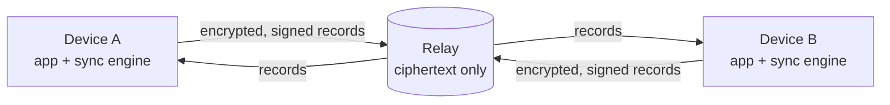

# Snailfish

[](https://github.com/bcrisp4/snailfish/actions/workflows/verify.yml?query=branch%3Amain)
[](https://pypi.org/project/snailfish/)
[](https://pypi.org/project/snailfish/)
[](#licence)

Snailfish is a self-hosted sync system for local-first apps. It keeps the devices of one person in sync. The server stores only ciphertext and holds no key.

## Status

Snailfish is pre-release. Milestones M1 to M9 of [DESIGN.md](DESIGN.md#milestones) are complete. The next step is the first public release.

| Part | Path | State |
| --- | --- | --- |
| Protocol | [PROTOCOL.md](PROTOCOL.md) | Complete, with shared test vectors |
| Relay | [crates/relay](crates/relay) | Complete. Ships as a container image. |
| Sync engine | [crates/engine](crates/engine) | Complete |
| Python binding | [bindings/python](bindings/python) | 0.1.0 on [PyPI](https://pypi.org/project/snailfish/) |
| Swift binding | [bindings/swift](bindings/swift) | Complete. Not published. |
| SwiftUI sample app | [apps/apple](apps/apple) | macOS and iOS. Not published. |

No third party audited the code or the protocol. The protocol and the formats can change before 1.0.

## How it works



- Each device encrypts and signs its changes before upload. The relay never holds a key.
- Each device checks the log that it gets from the relay, so it finds a relay that changes or rolls back records.
- A new device joins through a QR code and a 6-digit code match with a trusted device. The user keeps an offline recovery key.
- A small Rust relay runs on a VPS or a home server. It keeps one SQLite file for each app of each user.
- Apps use the Rust sync engine through the Swift and Python bindings.

## Quick start

To run a relay, follow [docs/self-host.md](docs/self-host.md). It sets up the relay and a Caddy proxy with Docker Compose.

To use the engine from Python 3.13 or later, install the package:

```bash
pip install snailfish
```

The [demo](demo) app is a complete Python integration.

## Verification

Formal models in [specs](specs) define the protocol behaviour. The Rust implementation must agree with them.

| Check | Tool | Scope |
| --- | --- | --- |
| Protocol state machines | Quint, Apalache, TLC | Sampled traces and finite configurations |
| Enrollment, removal and sign-in security | ProVerif | Symbolic attacker model |
| Protocol functions | Kani, property tests | Bounded inputs |
| Parsers | cargo-fuzz | Arbitrary bytes |
| Test strength | cargo-mutants | Each mutant of the Rust code |
| Crash safety | QEMU power loss tests | SIGKILL of a VM during sync |

Each result covers only its stated scope. [specs/README.md](specs/README.md) gives the tiers and their limits.

## Documentation

| Document | Content |
| --- | --- |
| [DESIGN.md](DESIGN.md) | Goals, design decisions and milestones |
| [PROTOCOL.md](PROTOCOL.md) | The exact bytes of each record and request |
| [docs/self-host.md](docs/self-host.md) | Relay setup, backups and monitoring |
| [docs/release.md](docs/release.md) | The release procedure |
| [CHANGELOG.md](CHANGELOG.md) | Changes in each release |
| [SECURITY.md](SECURITY.md) | How to report a vulnerability |

## Develop

1. Install [mise](https://mise.jdx.dev) and [rustup](https://rustup.rs).
2. Run `mise install` in the repo root. It installs every dev tool at its pinned version.
3. Run `make check` before each commit.
4. On macOS with Xcode, run `make test-swift`. It runs the shared vectors on an iOS simulator and on macOS.
5. Read [AGENTS.md](AGENTS.md) for the full verification workflow.

## Name

Snailfish live deeper than any other fish on record, more than 8,000 m down in ocean trenches. App data sinks ("syncs") to the relay, and it stays in the dark there, because the relay cannot read it.

## Licence

MIT OR Apache-2.0, at your option. See [LICENSE-MIT](LICENSE-MIT) and [LICENSE-APACHE](LICENSE-APACHE).
